# Sistema de determinação de verticalidade utilizando unidade de medidas inerciais

**Rafael José Mota Ocariz**<br>
Universidade Paulista — Engenharia da Computação — São José dos Campos<br>
Trabalho original de 2018 · Revisão técnica de 22 de outubro de 2026

Orientador do trabalho original: Prof. Dr. Rogério Moreira Cazo.

Esta versão em Markdown é a fonte editável da monografia. Preserva o conteúdo,
as figuras, as legendas, as tabelas e os resultados históricos, com as correções
e a extensão dinâmica identificadas no texto. A paginação, as folhas de aprovação
em branco e a ficha catalográfica do Word não são reproduzidas como se fossem
metadados de uma nova submissão. Não há nova aprovação institucional nem novos
resultados físicos.

Os originais de 2018 podem ser consultados no commit
`9a5279f5528d752bc9bc3225ec33e3b0dc0fcffa`. O PDF na raiz é um export histórico;
não corresponde à revisão atual e não é a fonte da monografia.

## Sumário

- [Resumo](#resumo)
- [Abstract](#abstract)
- [Lista de figuras](#lista-de-figuras)
- [Lista de tabelas](#lista-de-tabelas)
- [1. Introdução](#capitulo-1)
- [2. Fundamentação teórica](#capitulo-2)
- [3. Desenvolvimento](#capitulo-3)
- [4. Testes e resultados históricos](#capitulo-4)
- [5. Estimação dinâmica da verticalidade](#capitulo-5)
- [6. Conclusão](#capitulo-6)
- [Referências bibliográficas](#referencias)
- [Anexo A — Especificações históricas](#anexo-a)
- [Apêndice A — Códigos históricos](#apendice-a)
- [Apêndice B — Desenho mecânico](#apendice-b)
- [Apêndice C — Auditoria técnica](#apendice-c)

## Dedicatória

*Dedico este trabalho à minha família e aos meus\
amigos que sempre estiveram ao meu lado.*

## Agradecimentos

> *Agradeço primeiramente a DEUS por ser o pilar principal na minha vida, também a minha mãe, irmã e colegas que me apoiaram durante esta jornada e ao professor Rogério Moreira Cazo pelas suas orientações, incentivos e colaborações para a conclusão deste trabalho.*

*“O sucesso é ir de fracasso em fracasso sem\
perder o entusiasmo.”\
**Winston Churchill***

## Resumo

Este trabalho revisita o sistema de determinação de verticalidade desenvolvido em 2018 com Arduino Mega 2560 e MPU-6050. A versão original utilizava acelerômetros e medições estáticas. A revisão de 22 de outubro de 2026 introduz estimação contínua por girômetros e acelerômetros, propagação em quatérnios, correção vetorial da direção vertical, calibração explícita e indicação de falhas. A análise identifica erros de acumulação, correção de offset, quadrantes, fundamentação estatística e temporização na implementação histórica. As oito observações publicadas são preservadas como resultados históricos e não estabelecem desempenho dinâmico. A implementação é verificada por testes numéricos e compilação para o alvo; calibração individual, latência e erros físicos permanecem sujeitos a protocolo experimental. Uma IMU de seis eixos não determina rumo absoluto nem separa gravidade e aceleração translacional arbitrária sem informação adicional.

Palavras-chave: verticalidade, unidade de medidas inerciais, quatérnios, calibração, estimação de atitude.

## Abstract

This work revisits the verticality measurement system developed in 2018 using an Arduino Mega 2560 and an MPU-6050. The original implementation used accelerometer-only static measurements. The revision dated October 22, 2026 introduces continuous accelerometer and gyroscope processing, quaternion propagation, vector correction, explicit calibration and fault indication. The audit identifies historical accumulation, offset, quadrant, statistical and timing defects. Eight published observations remain historical results and do not establish dynamic performance. Numerical tests and a target compilation verify software properties; individual calibration, latency and physical errors require the specified experimental protocol. A six-axis IMU does not provide absolute heading or distinguish gravity from arbitrary translational acceleration without additional information.

Keywords: verticality, inertial measurement unit, quaternions, calibration, attitude estimation.

## Lista de figuras

- [Figura 1 - Um acelerômetro simples.](#figura-1)
- [Figura 2 - MEMS.](#figura-2)
- [Figura 3 - Representação dos ângulos de Euler.](#figura-3)
- [Figura 4 - Representação da rotação no eixo Z.](#figura-4)
- [Figura 5 – Representação da rotação no eixo y'](#figura-5)
- [Figura 6 - Dados medidos por um acelerômetro.](#figura-6)
- [Figura 7 - Representação de um diagrama de casos de uso.](#figura-7)
- [Figura 8 - Representação de um diagrama de implementação](#figura-8)
- [Figura 9 - Representação de um diagrama de sequência.](#figura-9)
- [Figura 10 - Arduino MEGA 2560.](#figura-10)
- [Figura 11 - MPU-6050 integrado na placa comercial GY-521.](#figura-11)
- [Figura 12 - Tela LCD selecionada em funcionamento.](#figura-12)
- [Figura 13 - Página inicial do Arduino IDE.](#figura-13)
- [Figura 14 - Janela do Enterprise Architect.](#figura-14)
- [Figura 15 - Ciclo de desenvolvimento e otimização do sistema.](#figura-15)
- [Figura 16 - Esquema de conexão do sensor no Arduino.](#figura-16)
- [Figura 17 - Montagem completa do sistema eletrônico.](#figura-17)
- [Figura 18 - Montagem mecânica.](#figura-18)
- [Figura 19 - Diagrama de caso de uso.](#figura-19)
- [Figura 20 - Diagrama de implantação.](#figura-20)
- [Figura 21 - Diagrama de sequência.](#figura-21)
- [Figura 22 - Algoritmo de cálculo de variação da verticalidade](#figura-22)
- [Figura 23 - Esboço da interface gráfica.](#figura-23)
- [Figura 24 - Desempeno de granito utilizado.](#figura-24)
- [Figura 25 - Realizando coleta de dados no eixo X positivo.](#figura-25)
- [Figura 26 - Dados sendo coletados pelo monitor serial da IDE do Arduino.](#figura-26)
- [Figura 27 - Testando botão para realizar medição.](#figura-27)
- [Figura 28 - Testando botão que zera as medições.](#figura-28)
- [Figura 29 - Teste por meio de impressão de texto de referência no console.](#figura-29)
- [Figura 30 - Dados obtidos na posição X positiva.](#figura-30)
- [Figura 31 - Dados obtidos na posição X negativa.](#figura-31)
- [Figura 32 - Dados obtidos na posição Y positiva.](#figura-32)
- [Figura 33 - Dados obtidos na posição Y negativa.](#figura-33)
- [Figura 34 - Dados obtidos na posição Z positiva.](#figura-34)
- [Figura 35 - Dados obtidos na posição Z negativa.](#figura-35)
- [Figura 36 - Cálculo de Inclinação Y - 60º negativos.](#figura-36)
- [Figura 37 - Cálculo de Inclinação Y - 60º positivos.](#figura-37)
- [Figura 38 - Cálculo de Inclinação Y - 45º positivos.](#figura-38)
- [Figura 39 - Cálculo de Inclinação Y - 45º negativos.](#figura-39)
- [Figura 40 - Cálculo de Inclinação X - 60º negativos.](#figura-40)
- [Figura 41 - Cálculo de Inclinação X - 60º positivos.](#figura-41)
- [Figura 42 - Cálculo de Inclinação X - 30º negativos.](#figura-42)
- [Figura 43 - Cálculo de Inclinação X - 30º positivos.](#figura-43)
- [Figura 44 - Transferidores 45/45 e 30/60 utilizados como referência.](#figura-44)
- [Figura 45 - Fluxo de aquisição e estimação contínua.](#figura-45)

## Lista de tabelas

- [Tabela 1 - Comparação de dados entre versões de Arduino.](#tabela-1)
- [Tabela 2 - Comparação entre as versões das IMU.](#tabela-2)
- [Tabela 3 - Custo total do protótipo.](#tabela-3)
- [Tabela 4 - Comparação do custo obtido com o custo máximo estimado.](#tabela-4)
- [Tabela 5 - Testes FSE realizados e seus resultados.](#tabela-5)
- [Tabela 6 - Levantamento dos resultados do Teste do cálculo de determinação de variação da vertical III.](#tabela-6)
- [Tabela 7 - Notação e unidades da revisão dinâmica.](#tabela-7)
- [Tabela 8 - Erro de direção vertical em simulações sintéticas.](#tabela-8)
- [Tabela 9 - Rastreabilidade resumida da revisão.](#tabela-9)

<a id="capitulo-1"></a>

## 1. Introdução

Um robô humanoide possui inúmeros sistemas de controle internos, um desses é o controle de postura, responsável por manter o robô em pé e estável e para isso é necessário controlar a atitude de várias peças que o compõe. Ainda assim, antes de projetar um sistema que controle a atitude é necessário saber como determinar a mesma.

A determinação de atitude tem por objetivo informar a um usuário o sentido e direção de apontamento de um objeto. Essa determinação, ou medição, é feita por meio de cálculos realizados sobre valores obtidos por blocos de sensores conhecidos como IMU (Unidade de Medidas Inerciais). Atualmente existem sistemas que determinam a verticalidade por meio de laser, porém com aplicabilidade distinta da sugerida para o projeto em questão.

O sistema a laser citado não informa a verticalidade do objeto, o dado obtido por meio de sua medição é se o corpo a que ele está fixado está ou não em posição vertical. Diante da necessidade levantada de determinar com precisão a atitude de um objeto atrelado a um fato secundário de que o mesmo deve possuir um baixo custo de produção. Outra necessidade apresentada é que, independente da atitude do objeto medido, o que o sistema de um robô precisa é da sua variação com a vertical, no caso a verticalidade do mesmo. Portanto, buscou-se ao longo deste trabalho responder ao seguinte problema: é possível determinar a verticalidade de um objeto mantendo o baixo custo e com precisão aceitável?

O objetivo geral da revisão é implementar estimação contínua de inclinação durante rotações, com o hardware original, distinguindo rastreamento giroscópico de referência acelerométrica confiável. Os objetivos específicos históricos abaixo são preservados para contextualizar o trabalho de 2018; o capítulo Estimação dinâmica da verticalidade define os objetivos, equações, implementação e critérios de aceitação da revisão.

- Especificar uma IMU de baixo custo capaz de atender ao projeto;

- Elaborar um código para Arduino que faça a aquisição de dados dos sensores para caracterização dos mesmos;

- Realizar os ensaios de caracterização dos sensores;

- Definir as equações necessárias para converter os dados obtidos com os sensores nos ângulos de variação do objeto medido com a vertical;

- Modelar e programar o software responsável por calcular a verticalidade do objeto medido;

- Programar interface homem máquina a ser impressa numa tela LCD (*Liquid Crystal Display*) com suporte à interação via toque na tela para apresentação de resultados.

Diante do ambiente competitivo por criar um sistema robótico com movimentos mais orgânicos e precisos e da necessidade de diversos sistemas de determinação de atitude distribuídos por um robô surge à proposta deste trabalho de apresentar uma solução barata e que forneça dados de verticalidade a fim de facilitar os cálculos posteriores em supersistemas que os utilizarão como entrada.

Para o desenvolvimento do presente trabalho foram utilizadas pesquisas bibliográficas, foi elaborada a modelagem e implementação de software embarcado e foram realizados ensaios em laboratório. A pesquisa bibliográfica baseou-se em livros, publicações científicas e artigos da internet na área de sensores, engenharia de controle e cálculo. A modelagem de software foi desenvolvida em sua totalidade dentro do ambiente fornecido pelo software *Enterprise Architect* e os ensaios em laboratório foram realizados utilizando os equipamentos existentes no LICS (Laboratório de Identificação, Navegação, Controle e Simulação) presente no Instituto de Aeronáutica e Espaço (IAE).

### 1.1. Trabalhos relacionados

Foram selecionados alguns trabalhos realizados em áreas correlatas ou que em algum ponto do mesmo exista uma atividade relacionada ao projeto aqui exposto.

O primeiro trabalho relacionado é o publicado por Ferreira et. al. (2008), assemelhando-se a este trabalho no uso de ângulos de Euler como ponto de partida para execução dos cálculos de determinação de atitude. Outro trabalho relacionado, porém com uma abordagem distinta, é o de Kalantari et. al. (2010). No decorrer de seu trabalho ele determina a vertical a partir de imagens obtidas por câmeras. Por fim um terceiro e último trabalho relacionado é a dissertação de mestrado de Oliveira (2013) onde ele calcula a atitude de um nanossatélite usando uma terceira técnica por meio de quatérnios.

### 1.2. Organização do documento

A organização conserva os capítulos e a apresentação do trabalho original. A fundamentação e a metodologia históricas receberam correções explícitas. O capítulo de testes preserva os ensaios de 2018. O novo capítulo Estimação dinâmica da verticalidade desenvolve referenciais, cinemática, calibração, seleção do observador, arquitetura contínua, verificação de software e limites físicos. A conclusão distingue os resultados históricos, a implementação nova e as medições ainda pendentes. Os apêndices contêm os códigos históricos, enquanto o repositório contém os fontes atuais e os procedimentos reproduzíveis.

<a id="capitulo-2"></a>

## 2. Fundamentação teórica

É de suma importância para um trabalho acadêmico que este esteja bem embasado. Partindo deste princípio, durante este capítulo serão introduzidos de forma clara e objetiva conceitos cruciais para compreensão do desenvolvimento e do produto final.

### 2.1. Verticalidade

Verticalidade é definida pelo dicionário da língua portuguesa como a qualidade daquilo que é vertical, ou seja, a qualidade do alinhamento com a vertical de um corpo. Então, para determinar-se a verticalidade, ou seja, o quão alinhado com a vertical o corpo medido está, deve-se antes determinar o que será compreendido como vertical.

#### 2.1.1. Vertical

Wikipédia (2013) descreve em seu artigo a vertical como a linha imaginária posicionada no centro do campo de visão do observador formada pela gravidade. Ele ilustra esta linha imaginária como a reta formada por uma corda fixada a um prumo, muito utilizado por pedreiros. Quando este se estabiliza a sua corda fica em posição perfeitamente vertical.

### 2.2. Unidade de medidas inerciais

Uma unidade de medidas inerciais reúne acelerômetros e girômetros; magnetômetros podem fornecer uma referência adicional. Na implementação histórica somente os acelerômetros foram utilizados. A revisão dinâmica processa os seis canais inerciais, com o modelo de força específica, as convenções e os limites de observabilidade definidos no novo capítulo.

#### 2.2.1. Acelerômetros

Segundo Aggarwal et. al. (2010), acelerômetros são sensores que medem a força específica em um plano de referência, que pode ser utilizado para determinar a aceleração de um corpo em movimento.

Um acelerômetro mede força específica. Somente em repouso ou quando a aceleração translacional é desprezível sua direção pode ser interpretada como a vertical para cima. O modelo f_B = R_NBᵀ(a_N − g_N), desenvolvido na revisão dinâmica, estabelece o sinal e evita confundir gravidade com força específica.

Uma tríade permite medir as três componentes da força específica; não separa, por si só, gravidade e aceleração de translação. Assim, as equações estáticas a seguir têm validade condicionada ao repouso e não constituem um estimador dinâmico completo.

O método utilizado por um acelerômetro para realizar tal medição é detalhado por Titterton & Weston (2004), eles explicam que uma pequena massa instalada no interior do sensor é conectada a uma mola. A deformação gerada na mola devidos às forças aplicadas na massa são traduzidas pelo sistema do acelerômetro e enviadas ao usuário. A Figura 1 ilustra o sistema descrito.

<a id="figura-1"></a>

**Figura 1 - Um acelerômetro simples.**

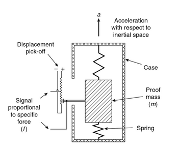

**Fonte: Titterton & Weston (2004)**

#### 2.2.2. Sistemas micro eletromecânicos

Devido a necessidade de se manter um baixo custo foi feita uma pesquisa por sensores que atendessem tal requisito. Aggarwal et. al. (2010) apresenta a tecnologia dos sistemas micro eletromecânicos (MEMS) como algo emergente e com grande potencial. Suas principais qualidades são o baixo custo, baixo consumo energético e fácil disponibilidade.

Aggarwal et. al. (2010) também ilustra o método de construção dos MEMS como a integração de elementos mecânicos, eletrônicos e sensores em um substrato comum baseado em silicone. A Figura 2 apresenta um dispositivo MEMS.

<a id="figura-2"></a>

**Figura 2 - MEMS.**

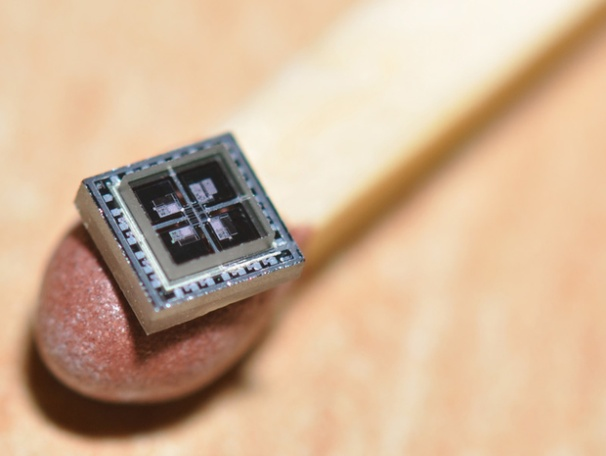

**Fonte: Ehrlich (2014)**

### 2.3. Método de representação dos ângulos

O método mais comum para representar ângulos é por meio de ângulos de Euler. Wie (2008) descreve a utilização de ângulos de Euler para determinar a orientação de um corpo por meio do uso de três rotações sucessivas. Estas rotações devem sempre respeitar a ordem de rotação de cada eixo. Existem doze conjuntos de rotações conhecidas e cada uma delas possui equações específicas.

Siciliano & Khatib (2008) apresentam os ângulos de Euler como três ângulos independentes que especificam a orientação de um corpo em rotação em referência a um corpo fixo.

Na Figura 3 pode ser visto a representação mais comum dos ângulos de Euler *α*, *β*, e *γ.*

<a id="figura-3"></a>

**Figura 3 - Representação dos ângulos de Euler.**

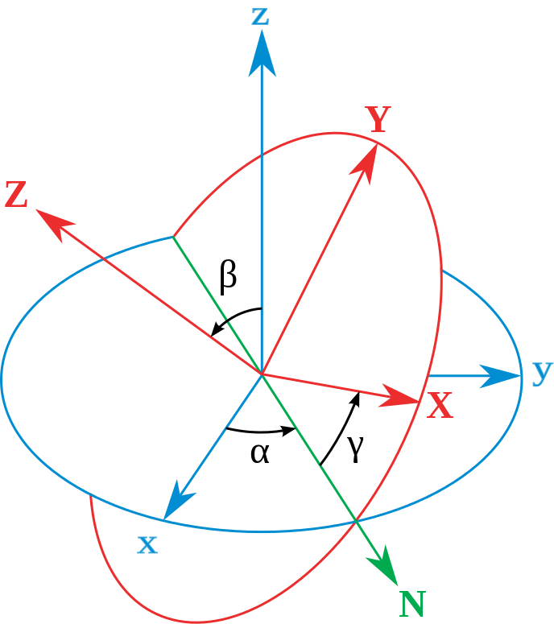

**Fonte: Wikipédia (2014)**

#### 2.3.1. Referência

“Em física, sistema de coordenadas de referência ou referencial é utilizado para se medir e registrar as grandezas físicas \[...\] Cada observador deve escolher um referencial para que se possa realizar suas medidas.” (Wikipédia, 2018).

O conceito de referência é muito importante, pois todos os dados medidos devem ser feitos em relação a algo. No caso esse algo é a referência, assim como visto na citação anterior. Neste projeto foram utilizadas duas referências, uma medida e outra estimada. A medida é a aceleração da gravidade, esta que representa uma linha imaginária no sentido vertical. A estimada é o plano horizontal, este não pode ser medido diretamente, mas pode ser estimado por meio da ausência da aceleração da gravidade numa medição com acelerômetros.

#### 2.3.2. Aplicação dos ângulos de Euler

Uma única direção vertical fornece duas componentes independentes de atitude, mas não determina o rumo absoluto. Isso não impede a utilização de ângulos de Euler como representação, desde que o rumo arbitrário e as singularidades sejam explicitados. A solução histórica a seguir restringe-se à inclinação estática. A revisão utiliza quatérnios na propagação e ângulos apenas para a apresentação, conforme o capítulo dinâmico.

Utilizando a metodologia apresentada por Titterton & Weston (2004), definiu-se o sistema de rotações na sequência zy’.

O motivo para tal é que a tríade acelerométrica montada no protótipo está alinhada com o eixo X para cima, Y para o leste e Z para norte. Como não há uma referência para o norte não serão utilizadas rotações no eixo x”.

No sistema desenvolvido serão determinados os ângulos *α* e *β* conforme ilustrados nas Figuras 4 e 5.

<a id="figura-4"></a>

**Figura 4 - Representação da rotação no eixo Z.**

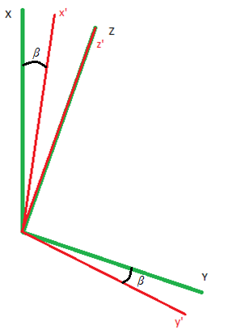

Fonte: Autor

Utilizando a Figura 4 como guia para os cálculos referentes à primeira rotação, obtém-se que:

```math
X = x'cos\beta - y'sen\beta
```

```math
Y = x'sen\beta + y'cos\beta
```

```math
Z = z'
```

Com base nessas equações pode-se montar a matriz que representa a primeira rotação no sistema proposto:

```math
\begin{bmatrix}
X \\
Y \\
Z
\end{bmatrix} = \begin{bmatrix}
cos\beta & - sen\beta & 0 \\
sen\beta & cos\beta & 0 \\
0 & 0 & 1
\end{bmatrix}\begin{bmatrix}
x' \\
y' \\
z'
\end{bmatrix}
```

<a id="figura-5"></a>

**Figura 5 – Representação da rotação no eixo y'**

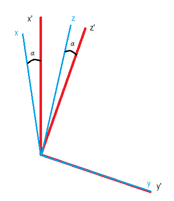

Fonte: Autor

Seguindo o mesmo processo efetua-se os cálculos de rotação no eixo *y’*. Obtém-se as equações:

```math
x' = xcos\alpha + zsen\alpha
```

```math
y' = y
```

```math
z' = - xsen\alpha + zcos\alpha
```

Montando a matriz da segunda rotação atinge-se o resultado:

```math
\begin{bmatrix}
x' \\
y' \\
z'
\end{bmatrix} = \begin{bmatrix}
cos\alpha & 0 & sen\alpha \\
0 & 1 & 0 \\
 - sen\alpha & 0 & cos\alpha
\end{bmatrix}\begin{bmatrix}
x \\
y \\
z
\end{bmatrix}
```

Logo, a matriz que relaciona a origem, no caso a referência, com a orientação final do corpo medido é dada por:

```math
\begin{bmatrix}
X \\
Y \\
Z
\end{bmatrix} = \begin{bmatrix}
cos\beta & - sen\beta & 0 \\
sen\beta & cos\beta & 0 \\
0 & 0 & 1
\end{bmatrix}\begin{bmatrix}
cos\alpha & 0 & sen\alpha \\
0 & 1 & 0 \\
 - sen\alpha & 0 & cos\alpha
\end{bmatrix}\begin{bmatrix}
x \\
y \\
z
\end{bmatrix}
```

Logo:

```math
\begin{bmatrix}
X \\
Y \\
Z
\end{bmatrix} = \begin{bmatrix}
cos\beta cos\alpha & - sen\beta & cos\beta sen\alpha \\
sen\beta cos\alpha & cos\beta & sen\beta sen\alpha \\
 - sen\alpha & 0 & cos\alpha
\end{bmatrix}\begin{bmatrix}
x \\
y \\
z
\end{bmatrix}
```

Como o sistema referência é constituído pela vertical e pelo plano horizontal, pode-se definir que a matriz de origem é:

```math
\begin{bmatrix}
X \\
Y \\
Z
\end{bmatrix} = \begin{bmatrix}
g \\
0 \\
0
\end{bmatrix}
```

Onde g é a aceleração da gravidade local. Utilizando o mesmo tipo de dados para definir a orientação do corpo medido, obtém-se os dados em unidade de engenharia medidos pelos acelerômetros:

```math
\begin{bmatrix}
x \\
y \\
z
\end{bmatrix} = \begin{bmatrix}
g_{x} \\
g_{y} \\
g_{z}
\end{bmatrix}
```

Onde g<sub>x</sub>, g<sub>y</sub> e g<sub>z</sub> são os dados medidos pelos sensores.

Porém estas equações ainda não informam os ângulos de variação do corpo com a vertical, ou seja, a verticalidade. Para isso deve-se montar um sistema linear de equações para determinar o valor de *α* e *β.* Por meio da matriz obtida e substituindo os valores conforme relacionado anteriormente, encontra-se o seguinte sistema linear de equações:

```math
\left\{ \begin{matrix}
g = g_{x}cos\beta cos\alpha - g_{y}sen\beta + g_{z}cos\beta sen\alpha \\
0 = g_{x}sen\beta cos\alpha + g_{y}cos\beta + g_{z}sen\beta sen\alpha \\
0 = - g_{x}sen\alpha + g_{z}cos\alpha
\end{matrix} \right.\
```

Como é possível observar, a terceira equação é a única que possui uma única variável, tornando simples a definição do valor da mesma:

```math
g_{z}cos\alpha = g_{x}sen\alpha
```

```math
\frac{g_{z}}{g_{x}} = \frac{sen\alpha}{cos\alpha} = tg\alpha
```

Logo:

```math
\alpha = {tg}^{- 1}\left( \frac{g_{z}}{g_{x}} \right)
```

Como o valor da aceleração da gravidade local varia conforme a latitude e altitude, então o mesmo não pode ser utilizado com precisão em qualquer lugar, então a primeira equação não pode ser utilizada sem antes definir uma equação que defina a aceleração da gravidade local. Para evitar a necessidade de tal cálculo então pode-se utilizar a segunda equação:

```math
sen\beta\left( g_{x}cos\alpha + g_{z}sen\alpha \right) + g_{y}cos\beta = 0
```

```math
\frac{sen\beta}{cos\beta} = tg\beta = \frac{- g_{y}}{g_{x}cos\alpha + g_{z}sen\alpha}
```

Logo:

```math
\beta = {tg}^{- 1}\left( \frac{- g_{y}}{g_{x}cos\alpha + g_{z}sen\alpha} \right)
```

### 2.4. Ruído

Com a finalidade de aumentar a precisão do cálculo para determinação da verticalidade deve-se aumentar a precisão dos dados medidos, para isso deve-se entender o que é ruído.

Silver (2012) descreve o ruído como aquilo que distrai o usuário da verdade. Observando a Figura 6 pode-se claramente identificar o ruído.

<a id="figura-6"></a>

**Figura 6 - Dados medidos por um acelerômetro.**

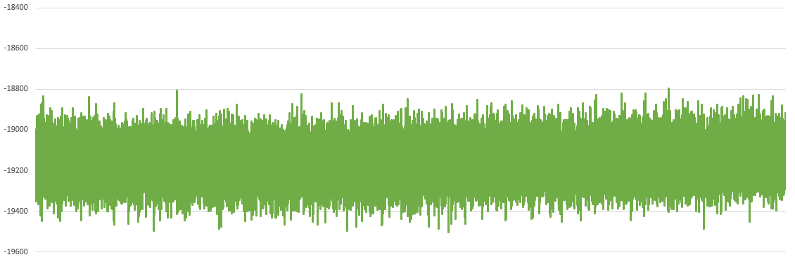

Fonte: Autor

O ruído é o que impede o usuário de obter o real valor medido pelo sensor, os dados ilustrados na Figura 6 apresentam ao sistema uma medição muito ampla, reduzindo grandemente a precisão da mesma.

A fim de aumentar a precisão do sistema é necessário adotar uma metodologia para tratamento de ruídos. Aggarwal et. al. (2010) apresenta a técnica da variância de Allan como a mais comum para a modelagem e determinação das características do ruído aleatório subjacente a um sensor MEMS.

#### 2.4.1. Tratamento de ruídos

Segundo obtido no Wikipédia (2016), existem algumas variações na forma de calcular a variância de Allan. Para este trabalho foi selecionada a variância M-Sample (M amostras) dada pela seguinte equação:

```math
\sigma_{y}^{2}(M,T,\tau) = \frac{1}{M - 1}\left\{ \sum_{i = 0}^{M - 1}{\left\lbrack \frac{x(iT + \tau) - x(iT)}{\tau} \right\rbrack^{2} - \frac{1}{M}}\left\lbrack \sum_{i = 0}^{M - 1}\frac{x(iT + \tau) - x(iT)}{\tau} \right\rbrack^{2} \right\}
```

Onde:

- x(t) é o ângulo de fase em radianos medido no tempo t ou a frequência fracionária média medida na amostra;

- M é o número de amostras;

- T é o tempo entre cada amostra;

- τ é o tempo de duração de cada amostra. Geralmente T e τ são iguais.

No caso será utilizada a frequência fracionária média para x(t), esta é obtida utilizando a seguinte formulação matemática:

>
> ```math
> \overline{y}(t,\tau) = \frac{x(t + \tau) - x(t)}{\tau}
> ```

Nesta equação x(t) é a média das medições realizadas no período t.

Porém, para atenuação do ruído será utilizado o desvio padrão de Allan, este calculado por meio da variância obtida:

```math
\sigma_{y} = \sqrt{\sigma_{y}^{2}} = \sqrt{\frac{1}{M - 1}\left\{ \sum_{i = 0}^{M - 1}{\left\lbrack \frac{x(iT + \tau) - x(iT)}{\tau} \right\rbrack^{2} - \frac{1}{M}}\left\lbrack \sum_{i = 0}^{M - 1}\frac{x(iT + \tau) - x(iT)}{\tau} \right\rbrack^{2} \right\}}
```

O desvio de Allan depende do tempo de média e não é necessariamente menor que o desvio amostral. Não justifica aplicar a regra gaussiana de duas vezes o desvio a observações individuais. As condicionais históricas abaixo descrevem o clipping implementado em 2018; a revisão não as utiliza. A definição estatística, unidades, hipóteses e alternativas são desenvolvidas no capítulo dinâmico.

```math
{Se\ g_{medido} > \overline{g_{medido}} + 2\sigma_{y}
}{então\ g_{medido} = \overline{g_{medido}} + 2\sigma_{y}}
```

E:

```math
{Se\ g_{medido} < \overline{g_{medido}} - 2\sigma_{y}
}{então\ g_{medido} = \overline{g_{medido}} - 2\sigma_{y}}
```

Após realizada a atenuação do ruído é então calculada uma nova média dos valores atenuados e esta média será entendida como o valor real da componente da aceleração da gravidade medida pelo sensor.

### 2.5. Caracterização de sensores

Outro passo necessário a fim de obter melhores medições de dados dos sensores é a caracterização dos mesmos. Por este processo entende-se como o levantamento de características dos sensores por meio de análise de dados obtidos em ensaios. Vale ressaltar que os dados levantados nos ensaios de caracterização serão utilizados para realizar os cálculos de tratamento de ruído discutidos anteriormente. Neste projeto serão estimados somente os valores de drift, fator de escala e ponto zero dos sensores acelerométricos.

Nyce (2016) descreve drift como a variação na medição realizada pelo sensor que acontece com o tempo mesmo que os dados do ambiente não sofram alteração. Como exemplo, num sensor de posição o drift é a diferença apresentada na posição num determinado tempo mesmo que o objeto medido não tenha mudado de posição.

A técnica para obtenção do valor de drift será simples: os dados obtidos serão particionados e a média dos valores da primeira partição serão comparada com a média dos valores da última partição. Será realizada uma análise no comportamento da medição do sensor para determinar se o mesmo apresenta período de drift mais severo ou se o drift é constante desde o início do período de operação do sensor.

Lawrence (2001) afirma que o fator de escala é a relação entre o valor de output do sensor e o valor medido. Porém, para calcular o fator de escala adequado é necessário definir o ponto zero do sensor, para isso coleta-se dados do valor máximo positivo e do valor máximo negativo, a média destes valores é considerado o valor zero do sensor e baseando-se nele pode-se obter a amplitude do valor bruto medido para realizar o cálculo de fator de escala. Logo:

```math
\overline{g} = \frac{g_{máx} + g_{\min}}{2}
```

```math
f_{escala} = \frac{g_{máx} - \overline{g}}{g_{ambiente}}
```

Onde:

- $`\overline{g}\ é\ o\ valor\ do\ ponto\ zero\ do\ sensor;`$

- $`f_{escala}\ é\ o\ valor\ do\ fator\ de\ escala;`$

- $`g_{ambiente}\ é\ o\ valor\`$da gravidade do ambiente;

- $`g_{máx}`$ é o valor máximo medido pelo acelerômetro num estado de repouso, este valor coincide com o valor de aceleração da gravidade no local.

Vale ressaltar que todos os dados de características que serão obtidos são fornecidos pelo fabricante com uma certa tolerância. A caracterização realizada visa apenas confirmar os dados recebidos por meio de datasheet.

Para obtenção dessas características são coletados dados por meio do teste conhecido como ensaio de quatro posições.

#### 2.5.1. Ensaio de quatro posições

Lawrence (2001) elucida a respeito deste ensaio que, apesar de seu nome, posiciona o sensor em seis posições distintas. Isso se deve ao fato de ser necessário obter dados de medição máxima e mínima para cada um dos três eixos ortogonais.

Outra variação deste ensaio apresentado pelo mesmo autor solicita vinte e uma posições para o ensaio. A quantidade de posições aumenta pois ele adiciona, além das posições com eixos alinhados, posições desalinhadas a trinta, quarenta e cinco e sessenta graus, respectivamente, para cada eixo, máximo e mínimo. Esta segunda variação do ensaio de quatro posições visa também avaliar o alinhamento dos sensores em sua integração mecânica na tríade. Como o sensor a ser utilizado é integrado dentro do chip MEMS então não há a necessidade de realizar esta variação do ensaio com maior coleta de dados.

O ambiente necessário para a garantia de sucesso do ensaio é rigoroso. O utilizado foi o fornecido pelo Laboratório de Identificação, Navegação, Controle e Simulação (LICS) presente no Instituto de Aeronáutica e Espaço (IAE). Foi utilizado um desempeno de granito classe 0, o que garante sua planicidade, posicionado sobre um bloco sísmico, evitando assim influências externas de vibração. O laboratório tem temperatura constante de 20°C com precisão de 0.5°C.

Foi decidido aplicar a atenuação de ruído pelo método apresentado anteriormente antes de realizar qualquer levantamento de característica do sensor, garantindo assim uma medição mais precisa para definição das propriedades solicitadas.

### 2.6. Engenharia de Software

Segundo Rezende (2005), engenharia de software é a arte de construir, com base no conhecimento científico e empírico, conjuntos ou subconjuntos de sistemas computacionais conhecidos como programas de computador ou software.

Segundo Carvalho e Chiossi (2001), a engenharia de software é uma disciplina constituída por metodologias e ferramentas a serem aplicadas a partir da percepção do problema até o momento em que o sistema desenvolvido se torna operacional, objetivando solucionar problemas relacionados ao processo de desenvolvimento e ao produto de software.

Para o projeto de software a ser idealizado para o projeto serão utilizados alguns diagramas introduzidos pela engenharia de software. Nos subcapítulos seguintes serão apresentados tais diagramas e seus conceitos a fim de elucidar suas funcionalidades.

#### 2.6.1. Diagrama de casos de uso

Melo (2010) descreve este diagrama como uma ferramenta para expressar as fronteiras do sistema, ou seja, os elementos do sistema que são visíveis aos atores que interagem com ele. A Figura 7 ilustra tal diagrama.

<a id="figura-7"></a>

**Figura 7 - Representação de um diagrama de casos de uso.**

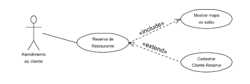

Fonte: Melo (2010)

O diagrama de casos de uso não tem como objetivo apresentar detalhes complexos de implementação do software.

#### 2.6.2. Diagrama de implementação ou implantação

Bezerra (2015) dá suma importância ao uso do diagrama de implementação durante a fase de elaboração do projeto. Ele também descreve a construção deste diagrama, onde se desenham estereótipos gráficos que fazem menção a elementos físicos do sistema e dentro desses elementos cartões com funcionalidades internas a eles. Cada elemento físico possui linhas de conexão entre eles e o mesmo vale para as funções, mostrando canais de comunicação e quais processos conversam entre si. A Figura 8 apresenta graficamente este tipo de diagrama.

<a id="figura-8"></a>

**Figura 8 - Representação de um diagrama de implementação**

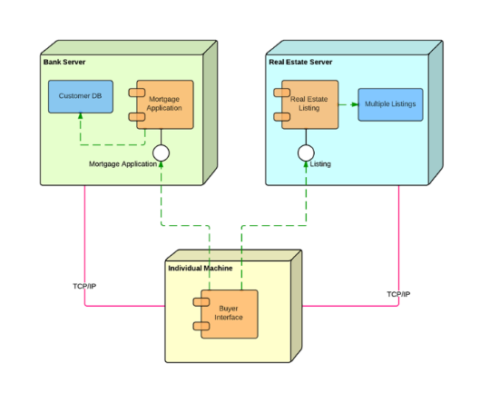

Fonte: Lucid Software (2018)

#### 2.6.3. Diagrama de sequência

Guedes (2018) apresenta este diagrama como do tipo comportamental, sua principal função é buscar, da melhor forma possível, ilustrar a sequência de eventos que ocorrem durante um determinado processo, indicando as mensagens a serem enviadas e quais elementos estão envolvidos. Ele ainda cria uma ligação entre este diagrama e o diagrama de casos de uso, afirmando que para cada caso de uso deve haver uma sequência definida. A Figura 9 apresenta este diagrama.

<a id="figura-9"></a>

**Figura 9 - Representação de um diagrama de sequência.**

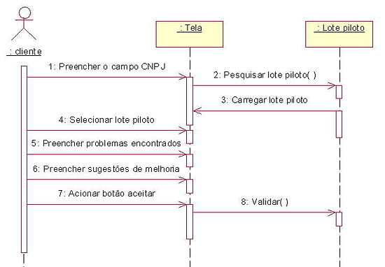

Fonte: Wikipédia (2018)

<a id="capitulo-3"></a>

## 3. Desenvolvimento

Este capítulo visa elucidar o leitor a respeito dos materiais utilizados e os critérios de seleção dos mesmos, a montagem do protótipo, o projeto de software por meio dos diagramas e a metodologia de desenvolvimento visando testes e otimização.

### 3.1. Materiais

Nesta seção serão apresentados os principais materiais utilizados para montagem do protótipo, sejam estes materiais físicos, ou seja, hardware ou softwares que foram utilizados para desenvolvimento do código e do projeto. Também será apresentada uma justificativa por trás da seleção de cada componente e ferramenta.

#### 3.1.1. Arduino

Segundo o Wikipédia (2017) o Arduino é uma plataforma de prototipagem eletrônica e de placa única com portas digitais, analógicas, PWM e tudo programado geralmente em C/C++ dentro do ambiente de desenvolvimento fornecido pela própria equipe de projetistas do Arduino.

Existem vários modelos do Arduino existentes no mercado, para atender as necessidades do sistema proposto o Arduino selecionado deve possuir uma quantidade de memória flash superior. Durante o processo de compra o Arduino a ser utilizado apareceram três opções com melhor fator custo/benefício.

A Tabela 1 apresenta uma comparação dos dados pertinentes referentes a cada uma dessas variantes do Arduino. Os dados foram obtidos por meio do site oficial do Arduino (2018) e os preços por meio do site Mercado Livre.

<a id="tabela-1"></a>

**Tabela 1 - Comparação de dados entre versões de Arduino.**

|  | **Arduino UNO** | **Arduino Due** | **Arduino MEGA 2560** |
|----|----|----|----|
| **Preço médio na internet (R\$)** | 55,00 | 110,00 | 70,00 |
| **Memória Flash (KB)** | 32 | 512 | 256 |
| **Clock (MHz)** | 16 | 84 | 16 |
| **SRAM (KB)** | 2 | 96 | 8 |

Fonte: Autor

Como pode ser observado o Arduino Due é uma opção extremamente mais poderosa que os demais, porém seu custo é mais elevado, inviabilizando-o. O Arduino UNO apesar de mais barato possui uma quantidade de memória flash e memória RAM muito baixa, ficando muito a desejar para as necessidades do projeto. A versão com custo médio mais adequado e que apresenta uma configuração que atende às demandas do projeto foi o Arduino MEGA 2560. A variante selecionada possui o processador ATMEL ATmega2560 e arquitetura RISC. A Figura 10 ilustra o componente selecionado.

<a id="figura-10"></a>

**Figura 10 - Arduino MEGA 2560.**

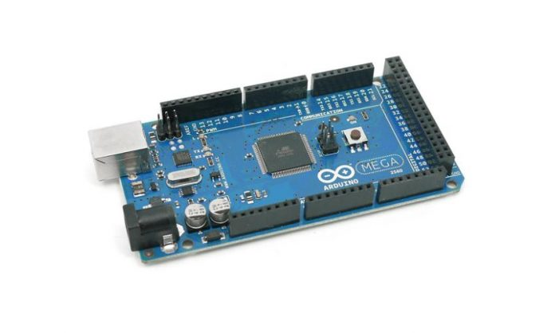

Fonte: Souza (2014)

#### 3.1.2. Unidade de medidas inerciais

Foram encontradas duas variantes de IMU no mercado, uma contendo termômetro, acelerômetros e girômetros e outra contendo ainda um magnetômetro, todos tri-axiais. A Tabela 2 apresenta as duas unidades e suas características mais relevantes para a análise e seleção de componente. Os dados presentes na tabela foram extraídos do datasheet de ambos os componentes no site da InvenSense (2018) e os preços obtidos pelo site Mercado Livre.

<a id="tabela-2"></a>

**Tabela 2 - Comparação entre as versões das IMU.**

|  | **MPU-9250** | **MPU-6050** |
|----|----|----|
| **Preço médio na internet (R\$)** | 40,00 | 19,00 |
| **Precisão do acelerômetro (%)** | ±3 | ±3 |
| **Velocidade de envio de dados (Hz)** | 4000 | 1000 |
| **Atenuação de ruído automática** | Sim | Não |
| **Alteração de sensibilidade vs. temperatura (%/°C)** | ±0.026 | ±0.02 |
| **Outros sensores** | Girômetro e magnetômetro | Girômetro |

Fonte: Autor

Como já mencionado anteriormente, para esta primeira abordagem será utilizado apenas o acelerômetro. A precisão de ambos é a mesma, eles possuem acelerômetros tri-axiais, atendendo às necessidades para o protótipo, o projeto já prevê aplicação de técnicas de tratamento de ruído, logo a atenuação automática não é algo relevante, e o custo no MPU-6050 é inferior. Estas foram as principais justificativas que levaram à seleção deste componente ao invés do MPU-9250.

A Figura 11 apresenta a IMU MPU-6050 integrada numa placa de circuito impresso em sua forma comercializada conhecida como GY-521. Casa haja a posterior necessidade, o MPU-6050 tem a capacidade de fazer fusão se sensor com um magnetômetro. As informações consideradas mais pertinentes a respeito deste componente estão disponíveis no Anexo A.

<a id="figura-11"></a>

**Figura 11 - MPU-6050 integrado na placa comercial GY-521.**

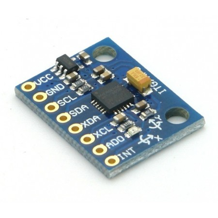

**Fonte: Ivanov (2017)**

#### 3.1.3. Tela LCD

Para facilitar a visualização dos resultados obtidos foi selecionada uma tela LCD com tecnologia de toque na tela que fosse de fácil integração com o Arduino selecionado e de baixo custo. Realizando uma pesquisa de mercado foi encontrada a tela com interface de integração, esta conhecida como shield, específica para o modelo de Arduino selecionado. Infelizmente este componente é o mais caro do protótipo. Para uma aplicação laboratorial existem outras soluções para acesso aos resultados da determinação de verticalidade que não envolvem o uso de uma tela LCD e com custo muito baixo e até nulo.

A tela selecionada e com custo médio de R\$180,00 é a TFT-320QVT com tecnologia de toque na tela resistiva e a respectiva interface para integração no Arduino foi a TFT LCD MEGA Shield V2.2 com valor de R\$22,00 produzida e vendida pela Elecfreaks. A Figura 12 apresenta a tela selecionada em funcionamento.

<a id="figura-12"></a>

**Figura 12 - Tela LCD selecionada em funcionamento.**

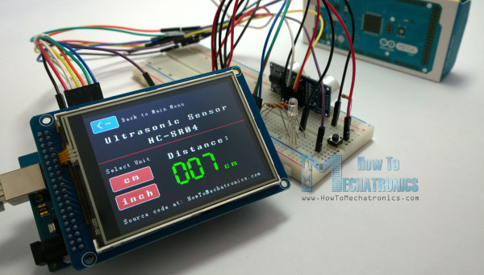

**Fonte: Dejan (2015)**

#### 3.1.4. Arduino IDE

O site oficial do Arduino fornece uma IDE para programação e gravação do Arduino, esta é escrita em JAVA e baseada no software Processing e outros softwares de código aberto. A versão utilizada para desenvolvimento do código neste projeto foi a 1.8.7. A Figura 13 apresenta a janela inicial de desenvolvimento deste software.

<a id="figura-13"></a>

**Figura 13 - Página inicial do Arduino IDE.**

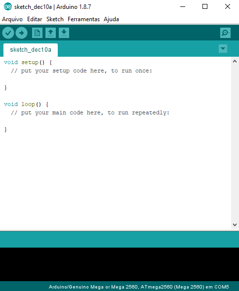

Fonte: Autor

Esta IDE foi selecionada devido ao fato de ser o ambiente de desenvolvimento oficial para o Arduino.

#### 3.1.5. Enterprise Architect

Software desenvolvido pela Sparx Systems para fazer modelagem, projeto, construção, teste e implantação de sistemas, sejam estes computacionais, de software, empresariais, etc.

Neste software é possível desenvolver diagramas UML para visualização dinâmica e até mesmo gerar automaticamente inúmeros diagramas baseando-se nos já modelados. É possível ainda realizar simulações e gerar automaticamente o código caso o software tenha sido bem projetado e modelado por meio dos diagramas disponíveis.

A Figura 14 mostra a janela deste software com um diagrama de sequência e um diagrama de requisitos.

<a id="figura-14"></a>

**Figura 14 - Janela do Enterprise Architect.**

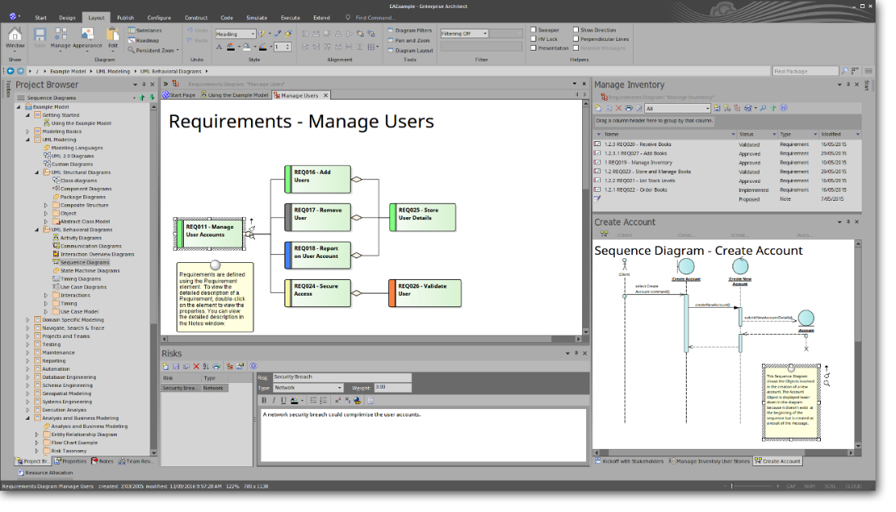

Fonte: Autor

O critério de seleção desta ferramenta de modelagem e projeto é a expertise do autor, que fez um curso de uso da ferramenta em dezembro de 2017 no Instituto Nacional de Pesquisas Espaciais (INPE) ministrado por professor contratado por empresa externa. Além disso o autor a utiliza em seu dia-a-dia de trabalho no Instituto de Aeronáutica e Espaço, logo, é uma ferramenta de fácil acesso e uso para o mesmo.

#### 3.1.6. Custo total do protótipo

Um dos critérios a serem atendidos é obter um baixo custo com o sistema, anteriormente foram apresentados os custos individuais de cada componente, na Tabela 3 é apresentado novamente estes custos juntamente com os custos totais atingidos.

<a id="tabela-3"></a>

**Tabela 3 - Custo total do protótipo.**

|                                         | **Valor(R\$)** |
|-----------------------------------------|----------------|
| **MPU-6050**                            | 19,00          |
| **Arduino MEGA 2560**                   | 70,00          |
| **Tela LCD TFT-320QVT**                 | 180,00         |
| **Shield Elecfreaks TFT LCD MEGA V2.2** | 22,00          |
| **Custo total do protótipo**            | 291,00         |
| **Custo total do sistema sem tela LCD** | 89,00          |

> Fonte: Autor

O custo do sistema para aplicação ficou relativamente baixo. A Tabela 4 apresenta o custo total do protótipo caso fossem selecionados o Arduino Due e o MPU-9250 e é feito um levantamento da porcentagem economizada com a seleção de componentes realizada.

<a id="tabela-4"></a>

**Tabela 4 - Comparação do custo obtido com o custo máximo estimado.**

|                                          | **Valor (R\$)** |
|------------------------------------------|-----------------|
| **Protótipo com peças selecionadas**     | 291,00          |
| **Protótipo com Arduino Due e MPU-9250** | 352,00          |
| **Economia (%)**                         | 17,33           |

> Fonte: Autor

A economia obtida pode parecer pequena na construção de um único protótipo, porém numa aplicação em um supersistema onde serão necessários uma quantidade maior de sensores e processadores ela mostra-se mais expressiva.

### 3.2. Metodologia de desenvolvimento

O processo de desenvolvimento foi dividido em etapas:

- Planejamento: nesta etapa inicial todo o escopo do trabalho foi definido e os processos para a obtenção do resultado final desejado foi arquitetado;

- Seleção dos materiais e ferramentas: discutido anteriormente neste capítulo, foi feita uma pesquisa dos materiais disponíveis no mercado e levantado seu fator custo/benefício para atender às necessidades do projeto;

- Montagem: nesta etapa foi feita a montagem eletrônica e mecânica dos componentes selecionados. Esta etapa será tratada com maiores detalhes posteriormente neste capítulo;

- Caracterização dos sensores: após selecionados todos os materiais, se deu início ao processo de caracterização dos sensores. Como já apresentado anteriormente o teste para aquisição de dados e levantamento de características dos acelerômetros foi o ensaio de quatro posições. Nesta etapa foram levantadas as características de variância e desvio padrão de Allan, ponto zero do sensor, drift e fator de escala;

- Projeto de software: detalhado posteriormente no decorrer deste capítulo, foi feito um projeto de software de forma a organizar e facilitar o processo de desenvolvimento do software embarcado do Arduino para que o protótipo atinja os objetivos dispostos anteriormente;

- Programação do Arduino: com o protótipo montado e o projeto de software concluído foi realizada a implementação do código na IDE do Arduino. Após o fim da programação o código foi embarcado. Os códigos elaborados para aquisição de dados dos sensores e o código final implementando a interface gráfica e execução das funções do projeto de software estão dispostos no Apêndice A;

- Testes de funcionamento: com o protótipo montado e o Arduino já carregado com o código, foram realizados testes de funcionamento do código. Estes testes serão detalhados posteriormente no capítulo separado para o mesmo;

- Otimização do produto: esta etapa marca o início e fim do ciclo de otimização do desenvolvimento do produto final. Após obtidos os resultados dos testes de funcionamento, estes servem como entrada para realizar um refinamento no projeto de software, caso os cálculos estabelecidos não estejam atendendo adequadamente aos objetivos do projeto os mesmos podem ser analisados e refinados. A Figura 15 apresenta um fluxograma que ilustra o ciclo de otimização.

<a id="figura-15"></a>

**Figura 15 - Ciclo de desenvolvimento e otimização do sistema.**

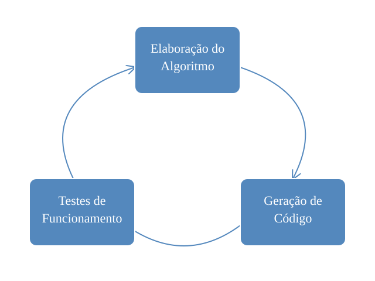

Fonte: Autor. Diagrama original reconstituído em SVG para esta edição.

### 3.3. Montagem do protótipo

A integração do protótipo foi feita em duas etapas:

- Montagem do sistema eletrônico;

- Montagem do sistema mecânico.

A montagem do sistema eletrônico foi bem simplificada graças à shield para integração da tela LCD ao Arduino. Infelizmente essa shield impede o uso dos bornes do Arduino após instalada, sendo necessário a instalação de uma régua de bornes na shield e as conexões feitas entre o sensor e o Arduino foram feitas também via shield. A Figura 16 apresenta o esquema elétrico desenhado para conexão do sensor ao Arduino, esta mesma ligação foi implementada na shield. Já a Figura 17 apresenta todo o sistema eletrônico integrado.

É possível observar o sensor montado na placa de interface. Um dos benefícios desta configuração de montagem foi a facilidade de enrijecer sua posição na montagem mecânica, impedindo assim que o sensor forneça ao sistema ruídos devido a folgas de montagem.

Não foi projetada uma alimentação via pilhas para o protótipo, logo o mesmo necessita estar conectado a um computador via USB (Universal Serial Bus) para que funcione.

<a id="figura-16"></a>

**Figura 16 - Esquema de conexão do sensor no Arduino.**

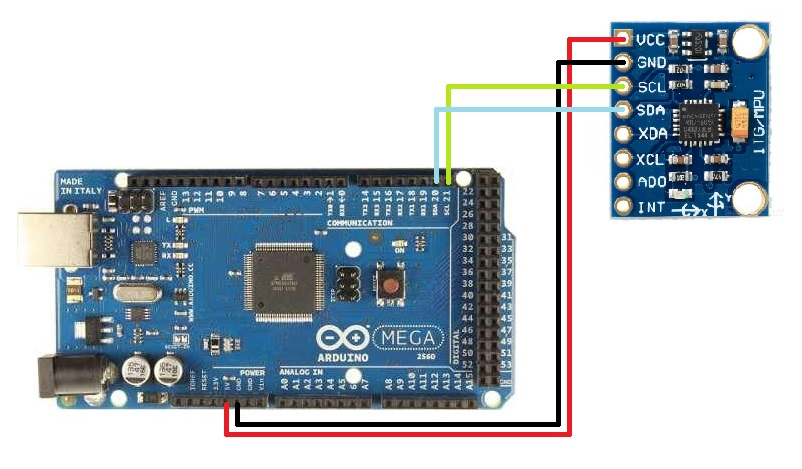

Fonte: Autor

<a id="figura-17"></a>

**Figura 17 - Montagem completa do sistema eletrônico.**

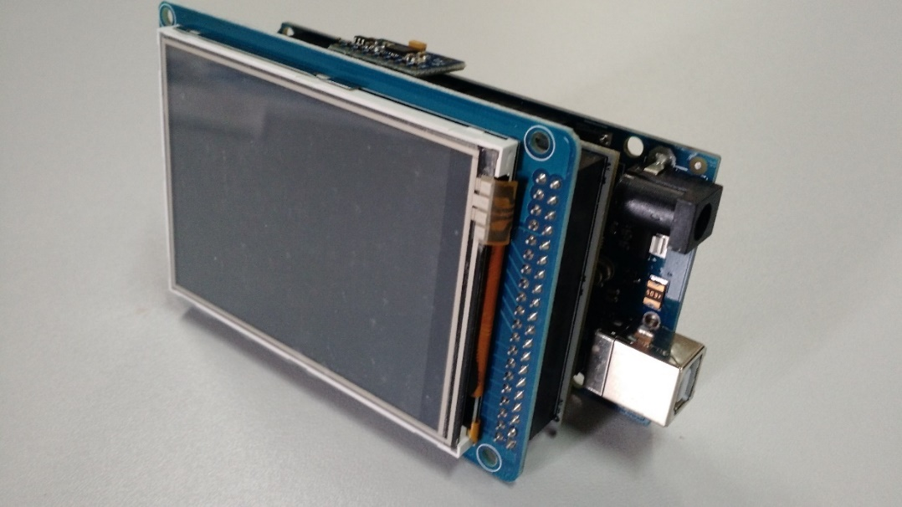

Fonte: Autor

A montagem mecânica foi a mais simplificada possível. Foi realizado o projeto de um case (caixa) e este foi impresso em 3D. Este processo de fabricação foi selecionado devido a sua facilidade e baixo custo. O desenho técnico do case projetado está no Apêndice B.

A montagem eletrônica foi então encaixada dentro da caixa. A tela LCD e o sensor foram parafusados na caixa. A Figura 18 ilustra o protótipo montado dentro da caixa de plástico.

<a id="figura-18"></a>

**Figura 18 - Montagem mecânica.**

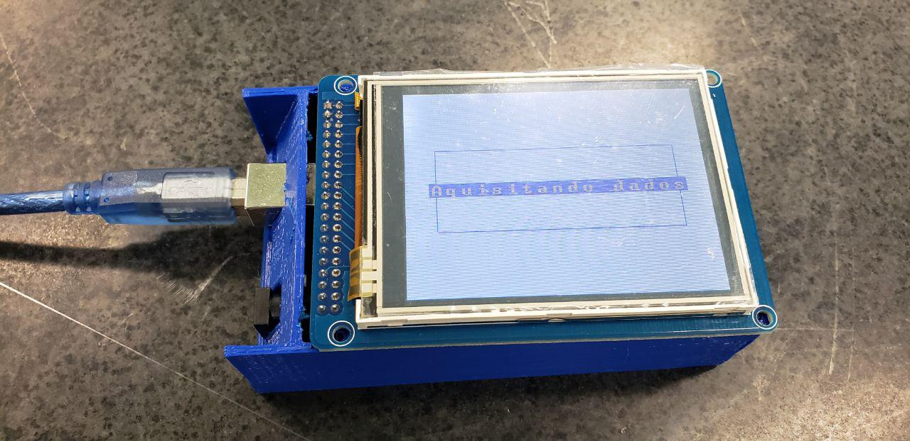

Fonte: Autor

### 3.4. Projeto de Software

Nesta seção serão apresentados e detalhados os diagramas elaborados no processo de engenharia de software. Foram selecionados alguns diagramas que tem aplicação coerente com o tipo de software desenvolvido, como o diagrama de casos de uso, diagrama de implementação, diagrama de sequência e um diagrama de fluxo para o algoritmo. Foi feito também um esboço da interface gráfica de forma a ter um objetivo claro durante a programação da interface a ser impressa na tela LCD.

#### 3.4.1. Diagrama de caso de uso

O sistema tem dois atores interagindo com o mesmo de maneiras distintas:

- O usuário realizando requisições para o sistema, no caso estas requisições são a solicitação da medição da verticalidade ou apenas zerar a medição realizada;

- O sensor, este interage com o sistema fornecendo dados para o algoritmo que está sendo executado.

As funções executadas pelo usuário incluem a execução do algoritmo para serem concluídas, isso será visto com mais detalhes posteriormente.

Estas funcionalidades foram selecionadas para evitar de haver erros de medição ou leitura. Caso o usuário esqueça se fez ou não a medição ele pode simplesmente solicitar que o sistema zere os valores medidos e depois realize uma nova medição. Vale ressaltar que não é necessário zerar os dados medidos para realizar a nova medição.

Por medição entende-se o processo de determinar os ângulos de variação do corpo com o sentido vertical, ou seja, sua verticalidade.

A unidade de memória não entrou como ator neste diagrama pois todos os elementos utilizados além dos dados lidos dos sensores são gerados dentro do próprio algoritmo.

A Figura 19 ilustra o caso de uso projetado para o sistema.

<a id="figura-19"></a>

**Figura 19 - Diagrama de caso de uso.**

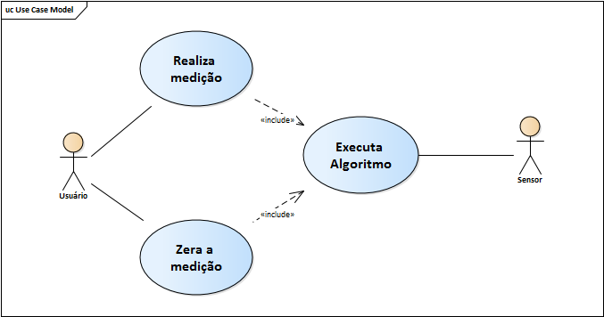

Fonte: Autor

#### 3.4.2. Diagrama de implantação

Com o objetivo de facilitar a visualização de onde estão sendo executadas as funções do sistema, foi elaborado este diagrama.

O protótipo contém três elementos de hardware:

- O Arduino, que é o ambiente de execução de todo o processamento;

- O sensor, que faz a aquisição de dados do ambiente;

- A tela LCD, que é o dispositivo de interface com o usuário.

A função embutida no sensor é a de coletar os dados acelerométricos do ambiente. Como o MPU-6050 é uma IMU ele fornece também dados girométricos e de temperatura. Outra função existente é a de enviar estes dados ao Arduino por meio da comunicação via I<sup>2</sup>C (Inter-Integrated Circuit), que nada mais é que um canal de comunicação FIFO (First-in First-out) digital.

A tela tem a função de imprimir a interface gráfica ao usuário e de coletar suas requisições via toque. O controle do sistema está embutido na tela, visto que o mesmo não executa nada sem uma solicitação do usuário, assim como visto no diagrama de caso de uso anterior.

O Arduino possui a função de executar o algoritmo que determina a verticalidade do sistema com base nos dados recebidos pelo sensor e os envia para a tela LCD para serem impressos ao usuário. É no Arduino que todo o processamento de computação gráfica é feito para atualizar a interface gráfica visualizada na tela. Foi definida uma função de interface interna no Arduino responsável por chamar a execução de uma das duas funções disponíveis ao usuário.

A Figura 20 ilustra toda essa funcionalidade explanada.

<a id="figura-20"></a>

**Figura 20 - Diagrama de implantação.**

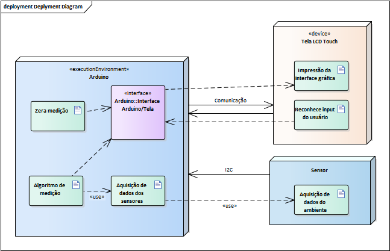

Fonte: Autor

#### 3.4.3. Diagrama de sequência

Complementando o diagrama de caso de uso, o diagrama de sequência apresenta, de forma linear, como o sistema executa cada função e quais os elementos envolvidos.

Pode-se observar, pela Figura 21, que o sistema inicialmente passa por um processo de inicialização. Este processo é inerente do sistema e a única interferência com o usuário é o fato do mesmo energizar o sistema. É devido ao fato de este processo não ser algo configurado pelo programa que ele não se encontra no diagrama de caso de uso anteriormente apresentado.

Logo em seguida o sistema fica em standby aguardando alguma solicitação do usuário. A interação do usuário é feita por meio de toque na tela, esta reconhece o toque e, caso haja solicitação, ela informa automaticamente o Arduino.

Quando o usuário solicita a realização de uma medição a tela LCD informa o Arduino disparando a requisição que executa o algoritmo de determinação de verticalidade.

Correção de 2026: o sketch histórico lê registradores de saída começando em 0x3B. Ele não habilita nem esvazia o FIFO. O sensor atualiza esses registradores independentemente da solicitação do usuário. A revisão verifica DATA_RDY, valida o burst de 14 bytes e reconhece a possibilidade de sobrescrita; o timestamp corresponde ao fim da leitura no Arduino, não ao instante físico da conversão.

Se a solicitação do usuário é o de zerar as variáveis que contém dos dados calculados ou medidos, então a tela informa o Arduino disparando assim a requisição de zerar as variáveis. A função atribui às variáveis o valor zero e logo em seguida atualiza a interface gráfica.

<a id="figura-21"></a>

**Figura 21 - Diagrama de sequência.**

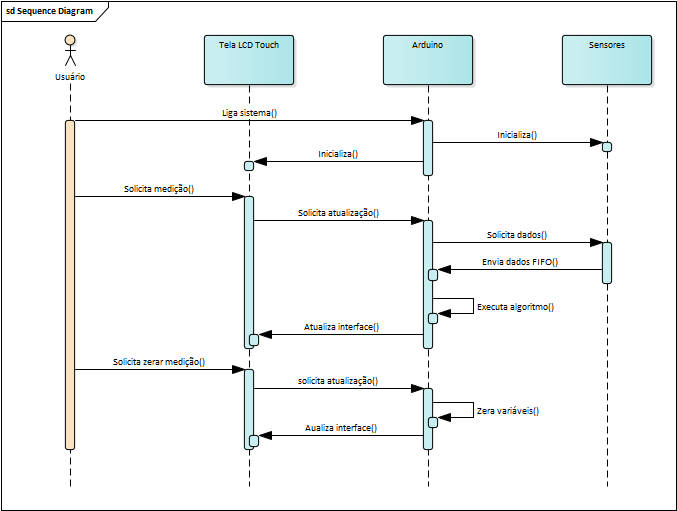

Fonte: Autor

#### 3.4.4. Algoritmo histórico de 2018

Para detalhar o processo do software que realizará a determinação da verticalidade foi modelado um algoritmo usando o fluxograma.

O algoritmo tem início com uma entrada manual (ou externa) do usuário solicitando a medição. Logo que a solicitação é realizada o índice do vetor que aloca os valores de medição de cada eixo do acelerômetro tri-axial é zerado.

O algoritmo histórico coleta 400 trincas de aceleração. Seus três vetores float ocupam 4800 bytes de SRAM, sem contar demais variáveis e pilha. Isso explica parte do consumo, mas não comprova que a quantidade de amostras causou os erros angulares. A revisão usa estatísticas em fluxo com memória constante e um ciclo contínuo independente da solicitação de medição.

O sistema então inicia a segunda etapa do processo, que é a etapa de atenuação do ruído por meio do uso do desvio padrão de Allan previamente calculado durante o ensaio de caracterização dos sensores. Os novos valores para as medições com ruído atenuado de g<sub>x</sub>, g<sub>y</sub> e g<sub>z</sub> são então salvas na memória usando o mesmo vetor usado durante a coleta de dados. Uma nova média é então calculada para cada um dos três eixos e salva na memória usando a mesma variável utilizada para salvar as médias inicialmente.

A auditoria identificou que a média anterior não era removida antes da segunda soma e que os acumuladores globais persistiam entre medições. Reutilizar uma variável não assegura correção nem reduz automaticamente a memória flash. Os programas históricos são mantidos para reprodução; o comparador corrigido e as regressões estão no núcleo e nos testes da revisão.

Com os dados finais de média para os três eixos o sistema então determina-se o valor de α utilizando a equação definida anteriormente durante a fundamentação teórica. Obtendo o valor de α e salvando-o na memória por meio de uma variável pode-se então determinar o valor de β usando a equação enunciada juntamente com a de determinação de α.

Com os valores de α e β o sistema então pode atualizar a interface gráfica apresentando ao usuário a variação do corpo em relação à vertical, ou verticalidade, calculada.

Todo o processo descrito pode ser observado na Figura 22.

No fluxograma pode-se notar que os dados dos sensores são recebidos de uma fonte externa ao algoritmo. Como já ilustrado anteriormente no diagrama de caso de uso onde o sensor é um ator que interage com o algoritmo.

Outro detalhe que vale ressaltar é que em nenhum momento o sistema exclui os dados medidos, logo estas variáveis são sempre sobrescritas quando um novo processo é executado. Os únicos valores que podem ser alterados fora do algoritmo são os calculados para α e β na função que zera os valores medidos.

<a id="figura-22"></a>

**Figura 22 - Algoritmo de cálculo de variação da verticalidade**

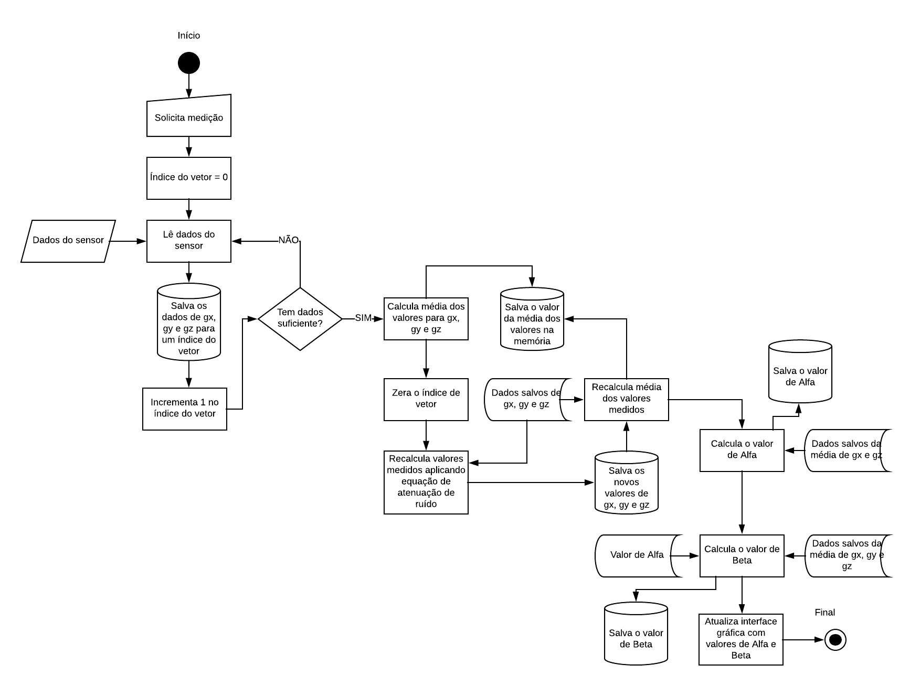

Fonte: Autor

#### 3.4.5. Interface histórica de 2018

A Figura 23 ilustra o esboço elaborado para a interface gráfica a ser impressa na tela.

Como é um esboço então a reprodução exata do que está contido no mesmo talvez não seja feita, porém todas as informações e o layout apresentado serão respeitados.

As principais informações apresentadas na tela são os valores para α e β, na interface nomeados de X e Y.

Também estão dispostos, na parte inferior da tela, dois botões com as funções de realizar a medição e de zerar a medição, assim como solicitado no diagrama de caso de uso. Para a realização da medição foi sugerido a implementação de uma barra de carregamento para que o usuário saiba qual a porcentagem do processo de determinação de verticalidade o sistema já executou.

Foi também inserido um cabeçalho contendo o nome do Projeto.

<a id="figura-23"></a>

**Figura 23 - Esboço da interface gráfica.**

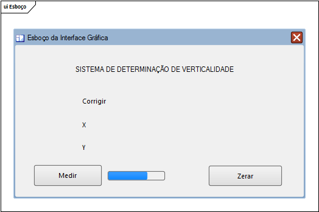

Fonte: Autor.

<a id="capitulo-4"></a>

## 4. Testes e resultados históricos

Este capítulo preserva os ensaios e resultados históricos de 2018. As classificações de sucesso registram a avaliação realizada à época, não a aceitação metrológica da revisão dinâmica. Os testes numéricos novos e o protocolo físico pendente estão no capítulo de estimação dinâmica e nos relatórios reproduzíveis do repositório.

### 4.1. Testes

Foram realizados dois tipos de testes:

- Ensaio de quatro posição para aquisição de dados que foram utilizados para a caracterização dos sensores;

- Teste de funcionamento de software embarcado (FSE): este teste visa garantir que o software projetado está funcionando adequadamente.

Todos os testes e ensaios foram realizados no LICS.

#### 4.1.1. Ensaio de quatro posições

Para a realização deste ensaio foi utilizado uma mesa desempeno de granito classe 0 como já descrito anteriormente. A temperatura do laboratório foi fixada em 20°C e o alinhamento do desempeno aferido com precisão de 0°0’1”, o que é desprezível devido à precisão do sistema sendo desenvolvido. É possível visualizar o desempeno utilizado na Figura 24.

<a id="figura-24"></a>

**Figura 24 - Desempeno de granito utilizado.**

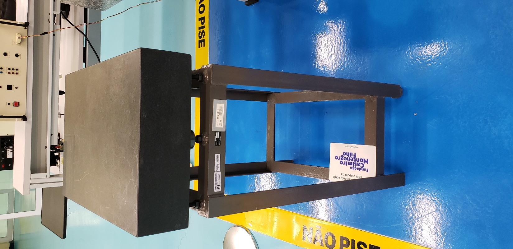

Fonte: Autor

Neste ensaio foram coletados dados acelerométricos dos três eixos em cada posição, porém só foram utilizados os dados obtidos do eixo relevante à cada posição.

As Figuras 25 e 26 mostram o procedimento de ensaio sendo realizado.

<a id="figura-25"></a>

**Figura 25 - Realizando coleta de dados no eixo X positivo.**

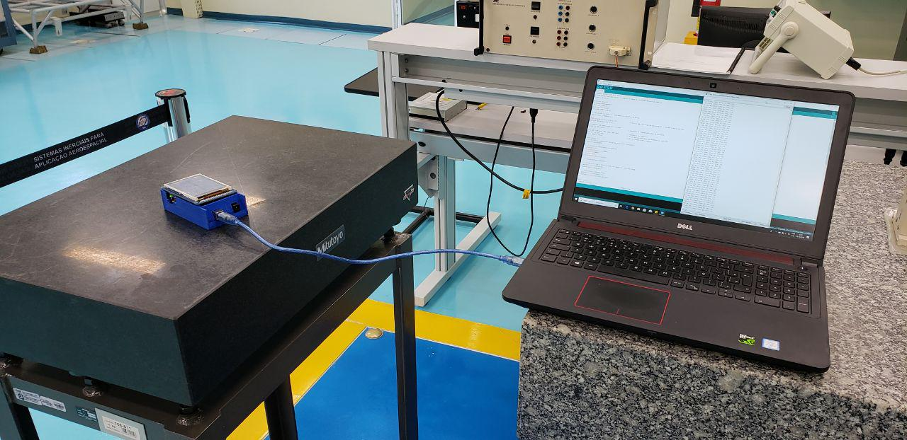

Fonte: Autor

<a id="figura-26"></a>

**Figura 26 - Dados sendo coletados pelo monitor serial da IDE do Arduino.**

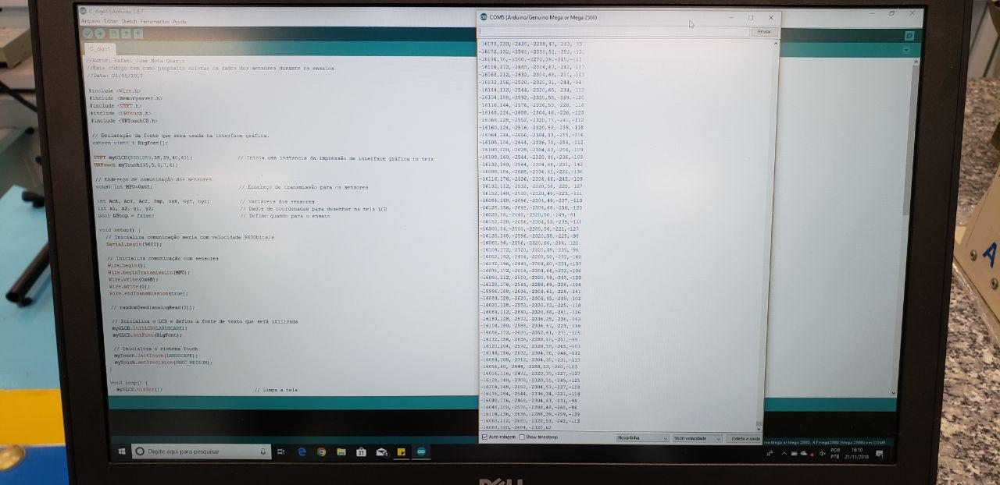

Fonte: Autor

#### 4.1.2. Teste FSE

O teste FSE foi feito em duas etapas.

A primeira etapa foi diretamente no protótipo, onde foram testadas as funcionalidades de interação do usuário com o sistema, ou seja, se o sistema recebe adequadamente as solicitações de zerar o sistema e de realizar a determinação da verticalidade do corpo medido.

As Figuras 27 e 28 ilustram esta primeira etapa do teste FSE, observe pelas imagens que o sistema reconheceu o toque na tela adequadamente e imprimiu na tela os dados calculados pelo sistema.

<a id="figura-27"></a>

**Figura 27 - Testando botão para realizar medição.**

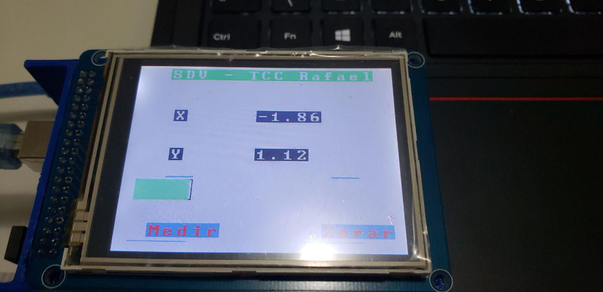

Fonte: Autor

<a id="figura-28"></a>

**Figura 28 - Testando botão que zera as medições.**

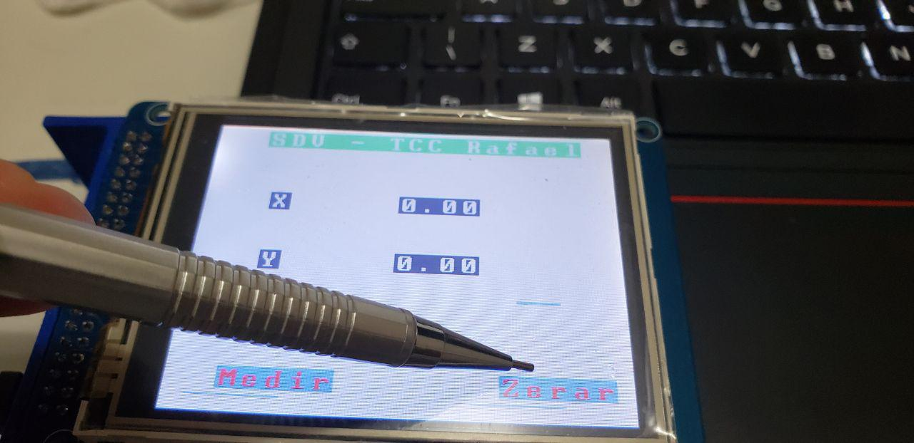

Fonte: Autor

A segunda etapa foi por meio de interação entre o protótipo e o computador, onde cada etapa do código executado realizava uma impressão no console indicando sua execução ou o resultado de sua execução. A Figura 29 ilustra esta segunda etapa do teste FSE.

<a id="figura-29"></a>

**Figura 29 - Teste por meio de impressão de texto de referência no console.**

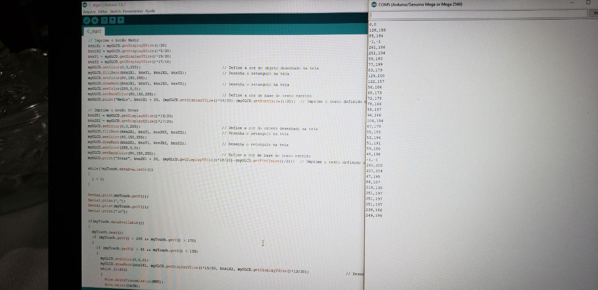

Fonte: Autor

### 4.2. Resultados

Após a realização de todos os testes, os dados coletados foram tratados e analisados de forma. Os resultados obtidos após cada teste podem ser vistos com mais detalhes nos subcapítulos seguintes.

#### 4.2.1. Ensaio de quatro posições

As figuras 30 a 35 apresentam os dados brutos obtidos no ensaio de quatro posições para cada um dos eixos medidos.

<a id="figura-30"></a>

**Figura 30 - Dados obtidos na posição X positiva.**

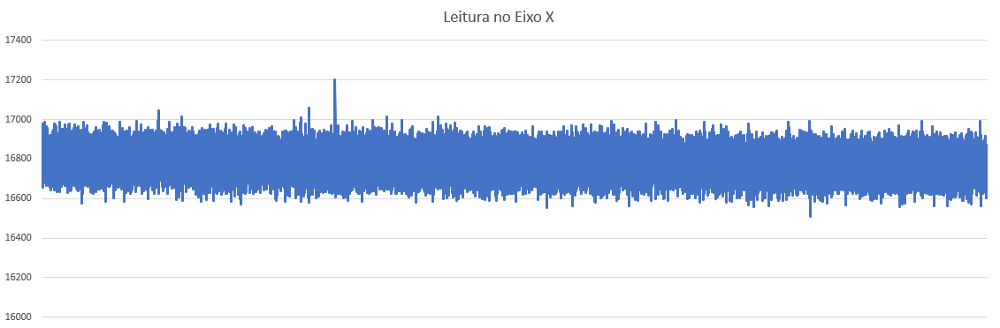

Fonte: Autor

<a id="figura-31"></a>

**Figura 31 - Dados obtidos na posição X negativa.**

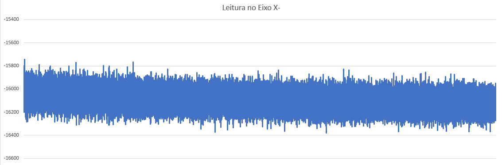

Fonte: Autor

O relato histórico informa uma hora e taxa de 30 Hz, totalizando 108000 registros por posição. O sketch disponível não impõe esse período, não transmite timestamps e pode ser limitado pela serial. Sem os dados brutos e os tempos de coleta, essa taxa efetiva não pode ser confirmada. A revisão transmite todos os canais e identificação temporal para tornar o ensaio reproduzível.

Na figura 32 é possível visualizar um spike na medição, isso deve ser causado por alguma interferência operacional no bloco sísmico durante a coleta dos dados.

<a id="figura-32"></a>

**Figura 32 - Dados obtidos na posição Y positiva.**

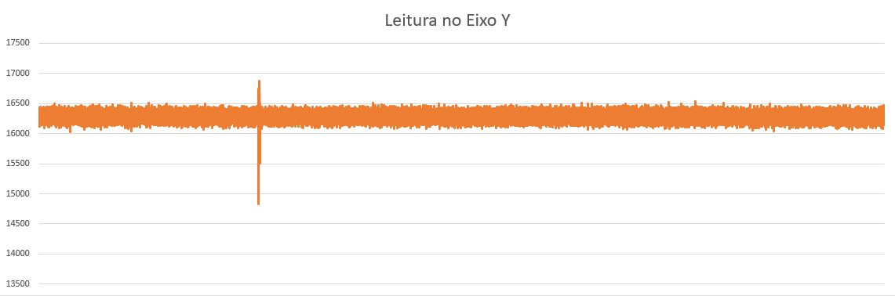

Fonte: Autor

<a id="figura-33"></a>

**Figura 33 - Dados obtidos na posição Y negativa.**

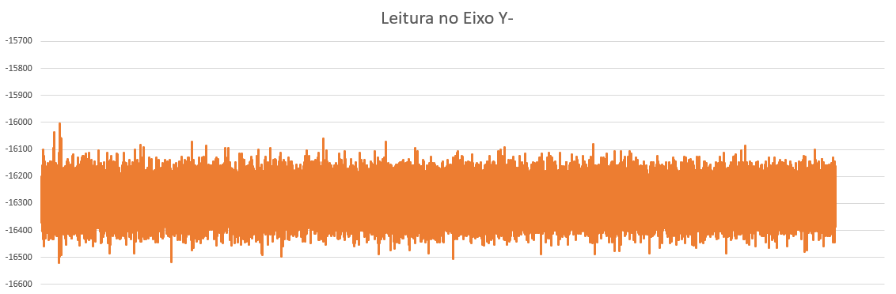

Fonte: Autor

<a id="figura-34"></a>

**Figura 34 - Dados obtidos na posição Z positiva.**

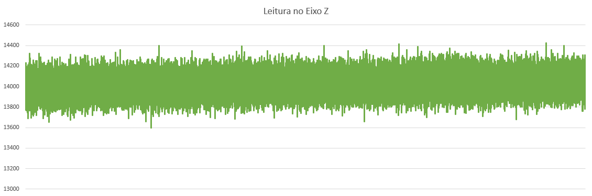

Fonte: Autor

<a id="figura-35"></a>

**Figura 35 - Dados obtidos na posição Z negativa.**

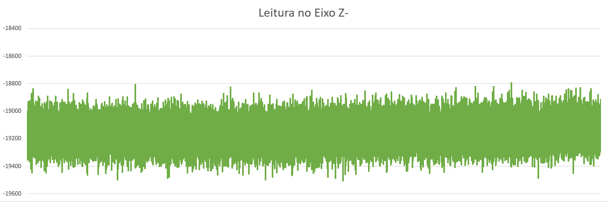

Fonte: Autor

O tratamento histórico dividiu cada registro em doze médias de cinco minutos. Como os dados brutos e o script não acompanham o repositório, os valores a seguir são resultados relatados, não recalculados. A equivalência do ruído nas posições positiva e negativa também não foi demonstrada. A revisão não utiliza esse desvio de médias como limiar gaussiano de clipping individual.

Com isso, aplicando-se a fórmula para calcular a variância de Allan, obteve-se os seguintes valores:

```math
\sigma_{x}^{2} = 259,8045
```

```math
\sigma_{y}^{2} = 327,4516
```

```math
\sigma_{z}^{2} = 1467,83
```

Já foi dito anteriormente que o cálculo da variância de Allan era apenas um passo para obter o real valor a ser utilizado no tratamento de ruídos: o desvio padrão de Allan. Com base nos valores obtidos foram calculados os seguintes valores para o desvio padrão de Allan:

```math
\sigma_{x} = 16,118
```

```math
\sigma_{y} = 18,096
```

```math
\sigma_{z} = 38,312
```

Após realizada a atenuação do ruído de todos os dados foi calculada a média dos valores por período de amostragem para realizar o cálculo do drift em porcentagem. Os dados obtidos de drift em uma hora foram os seguintes:

```math
{drift}_{x} = - 0,52\%/h
```

```math
{drift}_{y} = 0,04\%/h
```

```math
{drift}_{z} = 0,12\%/h
```

Foram calculados valores de ponto zero do sensor para cada um dos períodos da amostragem e no fim foi calculado um valor médio, os valores de ponto zero finais encontrados são os seguintes:

```math
g_{x}(0) = 344,968
```

```math
g_{y}(0) = - 2,197
```

```math
g_{z}(0) = - 2565,7
```

Os offsets impressos pertencem ao ensaio histórico. Há uma divergência entre o offset Y relatado (−2,197) e o utilizado no firmware (−2,917). Sem os dados brutos não se escolhe retrospectivamente qual constante reproduz o sensor; a nova calibração mede novamente as seis posições e registra a proveniência.

Finalmente, considerando a amplitude do sinal com os valores obtidos pode-se calcular o fator de escala dos sensores. Porém, antes é necessário determinar o valor da gravidade em São José dos Campos em *g*.

```math
g_{nível\ do\ mar} = 1g = 9,81m/s^{2}
```

```math
g_{São\ José\ dos\ Campos} = \frac{9,7962m}{s^{2}} = 0,9986g
```

Agora é possível obter os valores de fator de escala:

```math
f_{escala\ x} = \frac{16782,34 - 344,968}{0,9986} \cong 16400
```

```math
f_{escala\ y} = \frac{16083,07 - ( - 2,197)}{0,9986} \cong 16108
```

```math
f_{escala\ z} = \frac{14024,2 - ( - 2565,7)}{0,9986} \cong 16613
```

Correção aritmética de 2026: (16782,34 − 344,968)/0,9986 = 16460,4166, e não aproximadamente 16400 na precisão apresentada. A expressão histórica é preservada acima para rastreabilidade. Não se sabe se a origem foi transcrição ou dado de entrada. A revisão calcula os ganhos com novas médias e não considera que o ensaio estático identificou escala de girômetro ou todos os acoplamentos.

#### 4.2.2. Teste de funcionamento de software

A Tabela 5 apresenta todos os testes de funcionamento de software realizados e seus respectivos resultados.

<a id="tabela-5"></a>

**Tabela 5 - Testes FSE realizados e seus resultados.**

| Teste | Resultado | Comentários |
|:--:|----|----|
| Teste de conexão dos sensores | Sucesso | A comprovação de que a conexão foi realizada com sucesso é o fato de que os dados dos sensores foram lidos com sucesso. |
| Teste de inicialização da tela LCD I | Falha | O mapeamento dos pinos estava incorreto, após uma pesquisa minuciosa no datasheet do shield da tela LCD foram identificados os pinos adequados e reconfigurada a criação da instancia da tela no Arduino. |
| Teste de inicialização da tela LCD II | Sucesso | Após a devida reconfiguração a tela inicializou com sucesso e todos os testes de impressão de círculos, bitmaps e retângulos foram realizados com sucesso. |
| Teste de impressão de elementos na tela | Sucesso | Todos os objetos foram impressos adequadamente na tela LCD |
| Teste de reconhecimento de toque na tela I | Falha | Os pinos da configuração da instância do objeto que reconhece o toque na tela estavam incorretos, impedindo assim que qualquer toque pudesse ser reconhecido adequadamente. |
| Teste de reconhecimento de toque na tela II | Falha | As coordenadas do toque na tela e de impressão são diferentes, logo o sistema não reconhecia nenhum comando solicitado de toque na tela. |
| Teste de reconhecimento de toque na tela III | Sucesso | Após realizar um mapeamento adequado das coordenadas dos botões para toque e realizadas as configurações no código o toque na tela funcionou adequadamente. |
| Teste de funcionamento da barra de carregamento | Sucesso | A barra de carregamento informando ao usuário o estágio da medição funcionou adequadamente. |
| Teste do botão “Zerar” | Sucesso | \- |
| Teste do botão “Medir” | Sucesso | \- |
| Teste do cálculo de determinação de variação da vertical I | Falha | Valor medido não era coerente com a posição do corpo. |
| Teste do cálculo de determinação de variação da vertical II | Falha | Valor medido era coerente com a posição do corpo mas o sinal dos ângulos era o mesmo independente do sentido da inclinação. |
| Teste do cálculo de determinação de variação da vertical III | Sucesso | Classificação histórica: coerência visual. A causa do erro não foi isolada e o número de amostras não demonstra aceitação metrológica. |

Fonte: Autor

As Figuras 36 a 43 ilustram o teste de cálculo de determinação da verticalidade III e é possível ler na tela do protótipo os valores medidos de inclinação. Para X, ou valor de β, foram realizados testes a 30° e 60° e para Y, ou valor de α, foram realizados testes a 45° e 60°. Os esquadros utilizados como referência podem ser vistos na Figura 44.

<a id="figura-36"></a>

**Figura 36 - Cálculo de Inclinação Y - 60º negativos.**

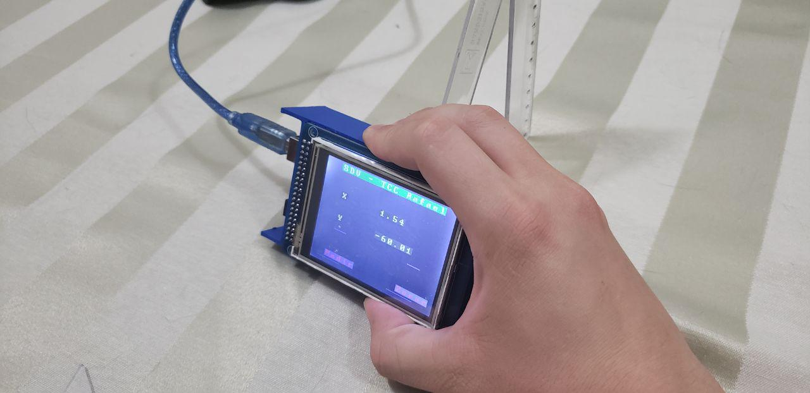

Fonte: Autor

<a id="figura-37"></a>

**Figura 37 - Cálculo de Inclinação Y - 60º positivos.**

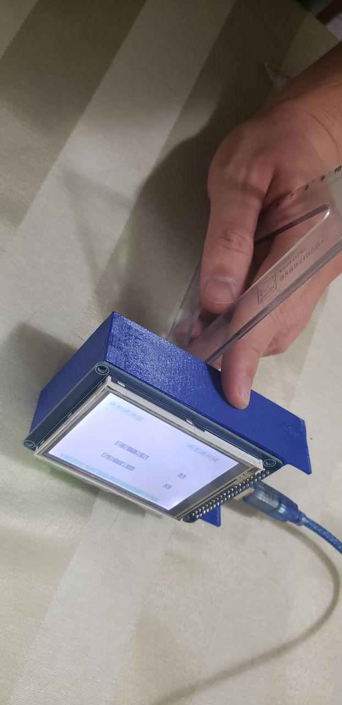

Fonte: Autor

<a id="figura-38"></a>

**Figura 38 - Cálculo de Inclinação Y - 45º positivos.**

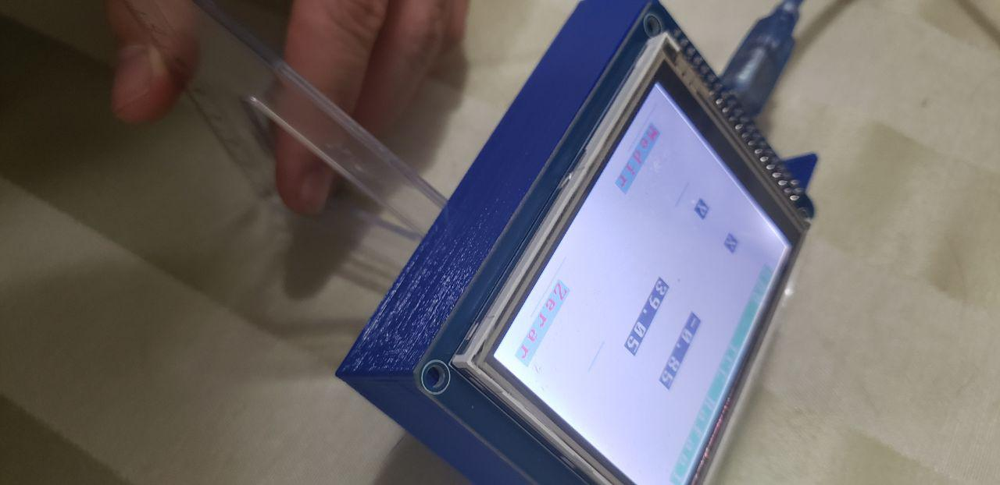

Fonte: Autor

<a id="figura-39"></a>

**Figura 39 - Cálculo de Inclinação Y - 45º negativos.**

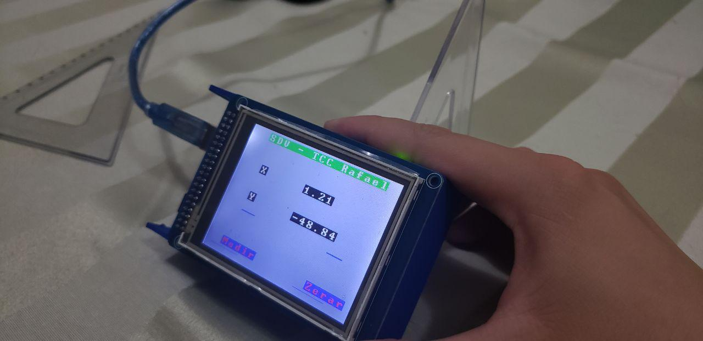

Fonte: Autor

<a id="figura-40"></a>

**Figura 40 - Cálculo de Inclinação X - 60º negativos.**

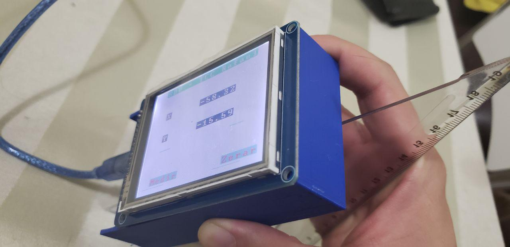

Fonte: Autor

<a id="figura-41"></a>

**Figura 41 - Cálculo de Inclinação X - 60º positivos.**

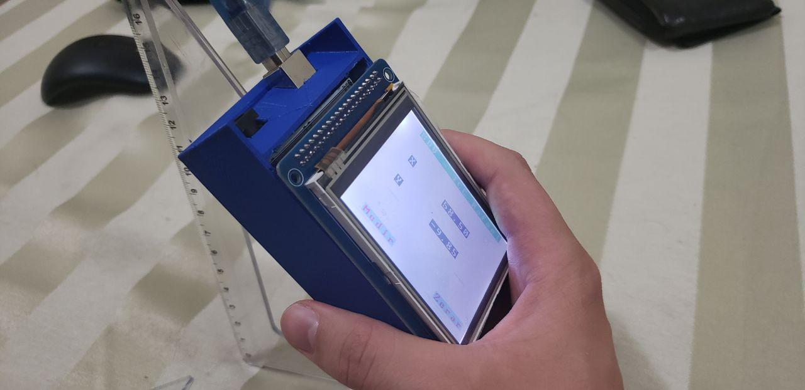

Fonte: Autor

<a id="figura-42"></a>

**Figura 42 - Cálculo de Inclinação X - 30º negativos.**

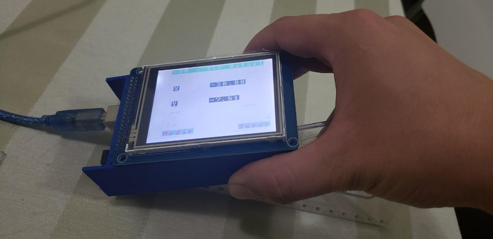

Fonte: Autor

<a id="figura-43"></a>

**Figura 43 - Cálculo de Inclinação X - 30º positivos.**

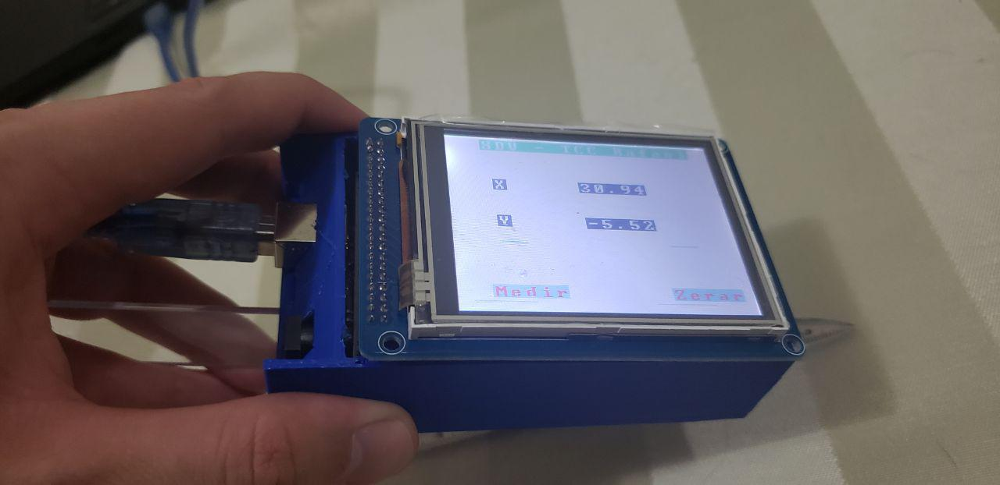

Fonte: Autor

<a id="figura-44"></a>

**Figura 44 - Transferidores 45/45 e 30/60 utilizados como referência.**

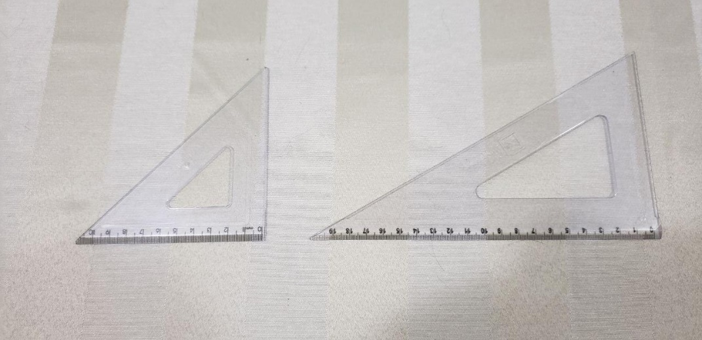

Fonte: Autor

Com base nos resultados obtidos foi montada a Tabela 6 contendo os ensaios e seus resultados:

<a id="tabela-6"></a>

**Tabela 6 - Levantamento dos resultados do Teste do cálculo de determinação de variação da vertical III.**

|                   | **-30** | **30** | **-45** | **45** | **-60** | **60** |
|:-----------------:|---------|--------|---------|--------|---------|--------|
|     **X (°)**     | -28,28  | 30,94  | \-      | \-     | -58,32  | 58,50  |
|     **Y (°)**     | \-      | \-     | -48,84  | 39,05  | -60,01  | 56,52  |
| **Erro em X (%)** | -5,73   | 3,13   | \-      | \-     | -2,8    | -2,5   |
| **Erro em Y (%)** | \-      | \-     | 8,53    | -13,22 | 0,02    | -5,8   |

Fonte: Autor

As oito leituras da Tabela 6 produzem erro absoluto médio de 2,39°, RMSE de 2,9827° e erro máximo de 5,95°. Esses resumos não constituem especificações ou intervalos de confiança. As hipóteses de erro a seguir não foram isoladas experimentalmente; mais amostras, por si só, não eliminam viés, montagem inadequada ou erros de algoritmo.

- Imprecisão do padrão utilizado;

- Erro de montagem do protótipo sobre o padrão;

- Erro mecânico de montagem do sensor na caixa do protótipo;

- Erro de esquadrejamento das superfícies externas da caixa do protótipo;

- Quantidade e correlação das amostras, hipótese não isolada; a atribuição dos erros à memória não foi demonstrada.

<a id="capitulo-5"></a>

## 5. Estimação dinâmica da verticalidade

### 5.1. Escopo e proveniência

Esta revisão de 22 de outubro de 2026 estende o trabalho de 2018 com uma implementação contínua para Arduino Mega 2560 e MPU-6050. O instrumento histórico era estático. Os resultados da Tabela 6 continuam históricos; não demonstram precisão dinâmica. A nova implementação tem verificação numérica e requer ensaios físicos. Os arquivos de 2018 permanecem recuperáveis no commit 9a5279f5528d752bc9bc3225ec33e3b0dc0fcffa. Esta revisão não representa nova aprovação institucional.

O problema passa a ser estimar a direção vertical durante rotações e intervalos de perturbação acelerométrica, indicando quando a referência é insuficiente. Não se propõe estimar posição nem rumo absoluto. A palavra precisão não deve substituir resolução, repetibilidade, erro ou incerteza de medição.

### 5.2. Referenciais e notação

N é o referencial local leste, norte e cima, destrógiro; B é o corpo do instrumento; S é o sensor. *R<sub>NB</sub>* transforma coordenadas de B em N. A montagem *R<sub>BS</sub>* deve satisfazer *R<sub>BS</sub>*ᵀ *R<sub>BS</sub>* = I e det *R<sub>BS</sub>* = +1. A configuração usa um quatérnio unitário para impedir reflexões. Identidade S = B é somente uma hipótese inicial que precisa ser verificada fisicamente.

A notação é: *a<sub>N</sub>* aceleração translacional em m/s²; *g<sub>N</sub>* = (0,0,−g) gravidade; *f<sub>B</sub>* força específica em m/s²; *u<sub>B</sub>* versor de força específica estática; *ω<sub>B</sub>* velocidade angular em rad/s; *b<sub>g</sub>* viés de girômetro em rad/s; *q<sub>NB</sub>* quatérnio unitário; Δt intervalo em segundos; *k<sub>P</sub>* ganho proporcional em s⁻¹; c contagens digitais; s sensibilidade em contagens/g. Vetores são colunas, rotações positivas seguem a mão direita e matrizes representam rotações ativas. As coordenadas se transformam conforme a direção indicada pelos índices.

<a id="tabela-7"></a>

**Tabela 7 - Notação e unidades da revisão dinâmica.**

| **Símbolo** | **Significado** | **Unidade ou convenção** |
|----|----|----|
| N, B, S | Navegação, corpo e sensor | Referenciais destrógiros |
| *R<sub>NB</sub>*, *R<sub>BS</sub>* | Transformações de coordenadas | B para N; S para B |
| *q<sub>NB</sub>* | Quatérnio de Hamilton | Escalar primeiro; norma unitária |
| *a<sub>N</sub>*, *g<sub>N</sub>*, *f<sub>B</sub>* | Aceleração, gravidade, força específica | m/s² no modelo físico |
| *u<sub>B</sub>*, v̂ | Direções medida e prevista | Versores sem unidade |
| *ω<sub>B</sub>*, *b<sub>g</sub>* | Taxa e viés giroscópico | rad/s no núcleo |
| c, *b<sub>a</sub>*, *s<sub>i</sub>* | Contagem, offset, sensibilidade | contagens; contagens; contagens/g |
| Δt, *k<sub>P</sub>* | Intervalo e ganho proporcional | s; s⁻¹ |
| X, Y, θ | Ângulos exibidos | Graus; +X como vertical de referência |

Fonte: Autor, revisão de 2026.

O modelo ideal e o sinal em repouso são:

```math
E1\ \ f_{B}\  = \ R_{NB}^{\mathsf{T}}\ (a_{N}\  - \ g_{N})
```

```math
a_{N}\  = \ 0\  \Rightarrow \ f_{B}/g\  = \ R_{NB}^{\mathsf{T}}\ (0,0,1)\  = \ u_{B}.
```

Portanto, em repouso, o acelerômetro mede a força específica para cima, não o vetor gravidade para baixo. O sinal é estabelecido por ensaios das seis faces. O núcleo recebe aceleração em unidades g e taxa em rad/s; somente as saídas são convertidas para graus.

### 5.3. Modelo dos sensores e calibração

```math
E2\ \ c_{a}\  = \ b_{a}(T)\  + \ K_{a}\ f_{S}/g_0\  + \ \eta_{a}\  + \ \varepsilon_{a}
```

```math
c_{g}\  = \ b_{c}(T)\  + \ K_{g}\ \omega_{S}\  + \ \eta_{g}\  + \ \varepsilon_{g}.
```

K contém sensibilidade e possíveis acoplamentos entre eixos; b depende da temperatura T; η é ruído e ε inclui quantização. Não se estima uma matriz completa de acoplamentos a partir de dados insuficientes. O modelo implementado é diagonal para aceleração, usa sensibilidade nominal de 131 contagens/(°/s) para o girômetro e transforma os dois vetores pela mesma rotação *R<sub>BS</sub>*. A sensibilidade nominal do acelerômetro em ±2 g é 16384 contagens/g; não é um certificado de calibração individual.

Para cada eixo i, medir as posições +i e −i, preservando todos os canais. Se a gravidade local é γ em g padrão, as médias ideais obedecem *μ<sub>i+</sub>* = *b<sub>i</sub>* + *s<sub>i</sub>* γ e *μ<sub>i−</sub>* = *b<sub>i</sub>* − *s<sub>i</sub>* γ. Somar e subtrair produz:

```math
E3\ \ b_{i}\  = \ (\mu_{i +}\  + \ \mu_{i -})/2
```

```math
s_{i}\  = \ (\mu_{i +}\  - \ \mu_{i -})/(2\gamma)
```

```math
a_{B}\  = \ R_{BS}\ diag(1/s_{i})(c_{a}\  - \ b_{a}).
```

Os resíduos nos eixos transversais permitem rejeitar montagem/alinhamento incompatível com o modelo diagonal, mas não separam perfeitamente erro da referência e não ortogonalidade. Uma calibração completa exigiria orientações conhecidas adicionais e ajuste com condicionamento e incerteza avaliados. O script registra arquivos, hashes, gravidade usada e identificação. As constantes históricas não são reutilizadas como novas medições.

A inicialização estima *b<sub>g</sub>* pela média de pelo menos 150 observações e três segundos contínuos em repouso, após conversão de unidades e montagem. Usa estatísticas de Welford, sem armazenar séries completas. As políticas de partida aceitam norma acelerométrica dentro de 0,08 g com ajuste medido ou 0,15 g no perfil nominal; variância máxima por eixo de 0,0004 g² e 0,000025 (rad/s)²; e norma giroscópica de até aproximadamente 70,28 °/s. Essa última margem é √3 × (20 + 20) + 1, motivada pelo offset inicial e pela variação térmica de catálogo nos três eixos, com 1 °/s adicional de engenharia. Não é uma garantia do fabricante nem um detector de repouso: rotação constante pode ser confundida com viés, e o operador deve imobilizar o instrumento. Não há adaptação automática de viés durante o rastreamento. Calibração estacionária não identifica escala ou não ortogonalidade do girômetro; isso exige referência de rotação.

A referência de fabricação é o documento InvenSense PS-MPU-6000A-00, revisão 3.4, seções 6.1–6.2: 16384 contagens/g em ±2 g, 131 contagens/(°/s) em ±250 °/s e tolerância de sensibilidade de ±3%. Os offsets acelerométricos de ±50 mg em X/Y e ±80 mg em Z são valores típicos após MSL3, não limites máximos garantidos. O offset inicial giroscópico a 25 °C e sua variação na faixa térmica são listados como ±20 °/s. O perfil nominal mantém ID zero e a marca de calibração medida desabilitada; após a partida estacionária, a tela e a telemetria identificam NOMINAL. As tolerâncias não são usadas como se fossem coeficientes individuais. As condições e o procedimento de seis posições estão em [calibração](docs/calibracao.md).

O autor relata que a caracterização original incluiu horas de aquisição acelerométrica e giroscópica em posições e rotações distintas, em laboratório profissional com isolamento de vibração e ambiente a 20 °C. A estrutura de ensaio está descrita no capítulo histórico. Os CSVs completos não foram recuperados para esta revisão; isso impede recalcular os coeficientes e não implica ausência dos ensaios originais. O perfil atual usa o manual como referência e estima novamente o viés de giro em repouso. A validação física específica do firmware dinâmico revisado permanece uma etapa distinta.

### 5.4. Cinemática e integração

Uma rotação infinitesimal no corpo dá R(t+dt) = R(t)(I + \[*ω<sub>B</sub>*\]×dt), onde \[ω\]×v = ω × v. Subtrair R(t), dividir por dt e tomar o limite fornece *Ṙ<sub>NB</sub>* = *R<sub>NB</sub>*\[*ω<sub>B</sub>*\]×. Usam-se quatérnios de Hamilton, escalar primeiro, com multiplicação:

```math
E4\ \ (p_0,p_{v})\  \otimes \ (q_0,q_{v})\  = \ (p_0q_0\  - \ p_{v} \cdot q_{v},\ p_0 q_v\  + \ q_0 p_v\  + \ p_{v}\  \times \ q_{v}).
```

O vetor transforma-se por (0,*v<sub>N</sub>*) = *q<sub>NB</sub>* ⊗ (0,*v<sub>B</sub>*) ⊗ *q<sub>NB</sub>*\*. Disso e da rotação infinitesimal (1,ωdt/2) resulta:

```math
E5\ \ \dot{q}_{NB}\  = \ \frac{1}{2}\ q_{NB}\  \otimes \ (0,\omega_{B}).
```

Trocar a ordem da multiplicação aplica taxas em outro referencial. Os testes de rotações X e depois Y verificam esse erro de forma independente pela ação da matriz *R<sub>X</sub>* *R<sub>Y</sub>* sobre vetores da base. Integrar p, q e r diretamente como taxas de três ângulos de Euler ignora a matriz cinemática dependente da atitude e falha em rotações compostas.

Para taxa constante no intervalo, φ = \|\|ω\|\|Δt e:

```math
E6\ \ \delta q\  = \ (\cos(\varphi/2),\ \omega\Delta t\ \sin(\varphi/2)/\varphi)
```

```math
{q^{-}}_{k}\  = \ normalizar(q_{k - 1}\  \otimes \ \delta q).
```

Quando φ → 0, sin(φ/2)/φ = 1/2 − φ²/48 + O(φ⁴). O código usa essa expansão e renormaliza. q e −q representam a mesma rotação. A conjugação é a inversa apenas para quatérnios unitários. A integração é exata para taxa constante, mas aproxima taxas variáveis por uma amostra; não elimina coning, aliasing nem atraso dos sensores.

### 5.5. Comparação e observador selecionado

O comparador estático calcula médias em fluxo, aplica calibração uma única vez e usa atan2. Tem memória constante e não distingue aceleração translacional de inclinação. Propagação somente giroscópica acompanha rotação a curto prazo, mas integra erros de viés. Um complementar escalar θ̂ = α(*θ̂<sub>anterior</sub>* + ωΔt) + (1−α)*θ<sub>a</sub>*, com α = exp(−Δt/τ), é útil em um plano e pequenas inclinações; generalizá-lo como três filtros independentes ignora a cinemática tridimensional. O observador vetorial em quatérnios evita essa singularidade na propagação.

Um filtro de Kalman com erro multiplicativo pode modelar erro angular e viés com covariância de seis estados e atualizações de direção. Exige Jacobianos consistentes, matrizes de ruído justificadas e tratamento da mesma ambiguidade física. Ele é possível no Mega, mas acrescentaria custo, memória e parâmetros sem dados que identifiquem suas covariâncias. A escolha do observador compacto é de escopo e verificabilidade, não uma afirmação de impossibilidade computacional do Kalman.

Inspirado no complementar explícito de Mahony, o código primeiro propaga q com *ω<sub>m</sub>* − *b̂<sub>g</sub>*. Depois calcula a direção prevista v̂ = (R⁻)ᵀe_z e a medida normalizada u = a/\|\|a\|\|. O produto vetorial u × v̂ gera o sinal corretivo:

```math
E7\ \ e\  = \ u\  \times \ \hat{v}
```

```math
q_{k}\  = \ normalizar({q^{-}}_{k}\  \otimes \ \operatorname{Exp}_q(k_{P}\ e\ \Delta t)),\ \ k_{P}\  = \ 2\ s^{-1}.
```

Exp_q é o incremento de E6. A atualização é uma divisão discreta entre propagação e correção, não reprodução exata do algoritmo contínuo publicado. Para pequeno erro angular transversal δ, e ≈ −δ e δ̇ ≈ −*k<sub>P</sub>*δ, justificando o sinal e uma constante de tempo local aproximada de 0,5 s em condições ideais. O teste de perturbação inicial verifica convergência. O viés é fixo após inicialização; *k<sub>I</sub>* = 0 no rastreamento. Assim, não se reivindicam os teoremas originais de convergência integral para esta variante, seus gates e seu único vetor de referência.

A correção requer 0,85 \< \|\|a\|\| \< 1,15 g e u·v̂ \> cos 30°. Esses limiares são heurísticos. Saturação, leitura inválida ou lacuna temporal invalidam a atitude; exigem nova inicialização. Aceleração rejeitada permite propagação giroscópica com estado SO GIRO. Grande erro direcional pode impedir recuperação espontânea: imobilizar e comandar C. A taxa de 50 Hz e *k<sub>P</sub>* são ponto de partida para ensaios, não parâmetros otimizados para resultados experimentais.

### 5.6. Observabilidade e perturbações

A gravidade fornece dois graus de informação; rotação em torno dela deixa *u<sub>B</sub>* inalterado. O rumo inicial é arbitrário e o yaw pode derivar. Em repouso, o erro de viés ao longo da vertical não é corrigível por esse único vetor; movimento e excitação alteram o que pode ser observado. A média estacionária estima os três canais assumindo taxa real nula, não demonstra observabilidade geral em movimento.

E1 também mostra a ambiguidade: para uma medida *f<sub>B</sub>* há combinações distintas de *R<sub>NB</sub>* e *a<sub>N</sub>*. Um gate de norma não resolve isso. Mesmo norma e inovação juntas podem aceitar uma direção errada: o vetor em g com componentes x = 0,1; y = 0; z = √0,99 tem norma 1 g e pequena inclinação aparente. O teste confirma falsa aceitação. Portanto, não se apresenta porcentagem de confiança e não se promete inclinação correta sob aceleração sustentada arbitrária.

Para sensor afastado do centro por r, a aceleração inclui *a<sub>origem</sub>* + ω̇ × r + ω × (ω × r), além de impactos, vibração e movimento da fixação. A rotação em uma perna robótica pode produzir aceleração centrípeta mesmo sem deslocamento do centro do robô. Reduzir braço de alavanca e melhorar rigidez ajuda; modelos de contato/cinemática, visão ou referências externas podem adicionar informação. Magnetômetro pode referenciar rumo, com limitações magnéticas, mas não remove sozinho a ambiguidade de toda aceleração translacional. Essas extensões ficam fora da implementação.

### 5.7. Ângulos exibidos e referência relativa

O eixo +X do corpo permanece a vertical de referência da interface histórica. Para *u<sub>B</sub>* = (*u<sub>x</sub>*,*u<sub>y</sub>*,*u<sub>z</sub>*) unitário, define-se:

```math
E8\ \ X\  = \ \beta\  = \ atan2( - u_{y},\ \sqrt{u_{x}^2 + u_{z}^2})
```

```math
Y\  = \ \alpha\  = \ atan2(u_{z},u_{x})
```

```math
\theta\  = \ acos(limitar(u_{x}, - 1,1)).
```

X pertence a \[−90°,90°\], Y a (−180°,180°\] com corte de ramo, e θ a \[0°,180°\]. Quando *u<sub>x</sub>*²+*u<sub>z</sub>*² ≈ 0, Y é indefinido e aparece como traços. A magnitude θ indica afastamento de +X e não fornece o sentido sozinha. Próximo de +X, X corresponde ao sinal histórico de β e Y ao de α; a revisão remove a ambiguidade de quadrante do atan de uma razão. Não se aplica a inversão simultânea dos três eixos do sketch antigo como rotação física, pois −I tem determinante −1.

Tara armazena X₀ e Y₀ e exibe diferenças de coordenadas com wrap em \[−180°,180°); não mede a rotação tridimensional relativa. θ permanece absoluto e está identificado assim. U remove a tara; R invalida a atitude; C solicita inicialização estacionária. Limpar a tela não é calibrar nem definir uma referência.

### 5.8. Ruído e incerteza

Para K médias de blocos adjacentes não sobrepostos de duração τ = mΔt, a variância de Allan de uma grandeza x é σ_A²(τ) = Σ(*x̄<sub>j+</sub>*1 − *x̄<sub>j</sub>*)²/\[2(K−1)\]. Seu desvio tem a mesma unidade de x e depende de τ, ruído, correlação e tamanho do registro. Para aceleração, a unidade é g, m/s² ou contagens conforme a série; não frequência fracionária automaticamente. O NIST SP 1065 é referência para a definição estatística, e suas fórmulas de relógios não são transferidas sem justificativa física. Allan não é necessariamente menor que o desvio amostral e não fornece um limite gaussiano de 95% para observações individuais.

Para pequeno viés acelerométrico perpendicular *b<sub>a</sub>*, em repouso δθ ≈ *b<sub>a</sub>*/g rad. Um erro de 0,01 g pode produzir cerca de 0,573°; é sensibilidade de primeira ordem, não especificação medida. Durante propagação livre, erro de taxa constante δb gera erro angular aproximado \|\|δb_perp\|\|t rad em pequenos ângulos. A incerteza da referência, alinhamento, temperatura, quantização e sincronismo devem entrar no orçamento experimental. Filtragem reduz variância e aumenta latência; menor dispersão não prova menor erro sistemático. Com amostragem de 50 Hz, a frequência de Nyquist é 25 Hz; DLPF_CFG=3 não constitui filtro anti-alias ideal. Ensaiar apenas movimentos de banda baixa inicialmente, medindo vibração e atraso.

### 5.9. Arquitetura e fluxo temporal

O ponto de entrada DynamicIMU.ino delega a inicialização e o ciclo principal a Application. Dentro do sketch, os módulos estão em src/application, src/hardware, src/sensors, src/processing, src/telemetry e src/ui. Mpu6050 configura e lê o sensor, disponibilizando amostras brutas com timestamp; Instrument aplica a calibração e controla o Observer, sem dependência de Arduino. O módulo hardware reúne a inicialização dos barramentos e do conjunto LCD/toque. Screen recebe os valores para exibição em um ViewModel e devolve ações dos botões à aplicação. A codificação dos pacotes é independente do transporte serial. A separação mantém o núcleo numérico portátil e permite verificar o estado do instrumento e a compatibilidade da telemetria no computador.

O fluxo implementado é registradores MPU → pacote assinado → calibração e montagem → verificação de inicialização → propagação → gate e correção → estado e ângulos → telemetria e uma linha do LCD. Nenhuma amostra é criada para preencher lacunas. O sensor é configurado em ±2 g, ±250°/s, PLL X, DLPF_CFG=3 e divisor 19; com clock de amostragem de 1 kHz isso fornece 50 Hz nominais. São verificados WHO_AM_I e registradores de configuração, inclusive a cada segundo. FIFO não é utilizado. DATA_RDY em INT_STATUS indica dado novo; os 14 bytes iniciados em 0x3B são lidos em burst. Repetição numérica em repouso não é falha por si só.

<a id="figura-45"></a>

**Figura 45 - Fluxo de aquisição e estimação contínua.**

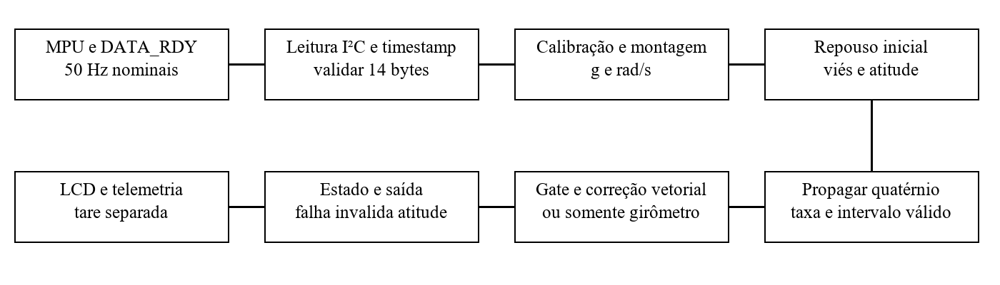

Fonte: Autor, revisão de 2026.

Timestamp é micros() ao terminar a leitura, não instante físico do sensor. Aritmética unsigned trata rollover de aproximadamente 71,6 minutos. Intervalos fora de 5 a 30 ms durante rastreamento invalidam a atitude. A fase do polling, I²C e filtro contribui para latência; perdas calculadas pelo intervalo são estimativas, não contagem exata das amostras sobrescritas. A leitura de status e o burst não são uma fila; há janela de corrida e amostras podem ser substituídas. Isso limita a afirmação de fidelidade temporal e precisa de medição. FIFO ou hardware externo pode ser necessário se o orçamento não fechar.

Cada passo do LCD altera uma linha, com duração máxima registrada. Inicialização gráfica ocorre antes da estimação. Se renderização ou toque bloquearem a aquisição, o sistema acusa falha temporal; não esconde uma redução de taxa. Exibir estado, traços para dado inválido, X, Y e tilt absoluto impede que uma atitude antiga pareça atual. É necessário medir o pior tempo das chamadas UTFT/URTouch no hardware e ajustar a estratégia antes de aceitar a taxa. Não se reutiliza INT no pino 2, pois ele já pertence ao toque.

A telemetria binária tem 80 bytes por amostra, CRC-16 e sequência. A 50 Hz são 4000 bytes/s, ou 40000 bits/s com UART 8N1, 34,7% de 115200 baud. O buffer de uma mensagem é transmitido somente conforme availableForWrite(); se ocupado, conta descarte de telemetria, sem bloquear o estimador. Os pacotes incluem sete canais brutos, timestamp, quatérnio, viés, estados, identificação e contadores. Não há persistência EEPROM nem escrita repetitiva de calibração.

### 5.10. Verificação e aceitação

Os testes determinísticos verificam produtos e rotações em bases conhecidas, sinais de bytes, unidades, seis faces, quatérnios opostos, inversão, pequenas rotações, quadrantes, singularidades, tara, partida estacionária, movimento rejeitado, saturação, dados não finitos, rollover, lacunas e yaw livre. Rotações de taxa constante por vinte segundos são comparadas com Rodrigues e eixo-ângulo analíticos a 50 e 100 Hz, tolerância de 0,02°. A implementação não recebe permissão para integrar uma taxa antiga por intervalos arbitrários. Casos com norma de 1 g e direção corrompida demonstram o limite do gate.

<a id="tabela-8"></a>

**Tabela 8 - Erro de direção vertical em simulações sintéticas.**

| **Cenário sintético** | **Fusão RMSE** | **Só giro RMSE** | **Estático RMSE** |
|-----------------------|----------------|------------------|-------------------|
| smooth_50hz           | 0.1143°        | 0.4022°          | 0.1569°           |
| jitter_100hz          | 0.0544°        | 0.1846°          | 0.1600°           |
| acceleration_50hz     | 0.1175°        | 0.4022°          | 6.2046°           |
| bias_change_50hz      | 0.4077°        | 3.4310°          | 0.1569°           |

Fonte: Autor, revisão de 2026.

Referência independente por matrizes de Rodrigues, vinte subpassos por amostra, duração de 23 s e semente 20261022. A avaliação exclui somente a inicialização pré-definida. No cenário de mudança de viés, o comparador estático tem menor RMSE que a fusão; a fusão não é superior em toda condição. Os erros completos de atitude, sensíveis ao yaw, estão separados no JSON. Estes números são de software, não medições físicas.

As regressões históricas mostram que observações Z constantes em −2540 contagens são recortadas para −76,62 quando o centro é deslocado para zero antes do clipping: corrupção de 2463,38 contagens. Uma média inicial de 1000 retida no segundo acumulador gera 1002,5 em vez de 1000 com 400 amostras. O comparador em fluxo elimina ambos os mecanismos. A expressão impressa do ganho X resulta em 16460,4166, não 16400. Sem dados brutos não se decide se o valor correto do experimento era o numerador ou a constante usada; novas calibrações substituem essa dúvida.

Recalculando oito leituras publicadas na Tabela 6: erro absoluto médio 2,39°, raiz do erro quadrático médio 2,9827° e erro absoluto máximo 5,95°. Não há repetições ou incerteza suficiente para transformá-los em limites do instrumento. Custos e disponibilidade de componentes da versão original são históricos de 2018.

O [protocolo de bancada](docs/validacao-bancada.md) define referências, repetições, sincronismo, temperatura, perturbações e critérios provisórios. Os relatórios de software são separados dos ensaios físicos pendentes. A revisão não comprova acurácia em robô caminhando. A aceitação exige medir latência, perdas, tempo de LCD, memória de pilha e erros contra uma referência apropriada.

### 5.11. Rastreabilidade e referências da revisão

E1–E3 correspondem a Calibration::accel, Calibration::gyro e scripts/calibrate.py; E4–E6 a Quat, increment e aos testes analíticos; E7 a Observer::sample e convergência; E8 a inclination e testes de quadrantes/tara. Aquisição e falhas correspondem a Mpu6050, Instrument e Application, além do protocolo de bancada. Esta seção reúne a correspondência entre as equações, a implementação e a verificação em software.

<a id="tabela-9"></a>

**Tabela 9 - Rastreabilidade resumida da revisão.**

| **Equações ou requisito** | **Implementação** | **Verificação** |
|----|----|----|
| E1–E3 | Calibration e calibrate.py | Bytes, ganhos, seis faces e fixtures |
| E4–E6 | Quat e increment | Rodrigues e rotações X/Y |
| E7 | Observer::sample | Convergência e falsa aceitação |
| E8 | inclination e tare | Quadrantes e singularidade |
| Aquisição e falhas | Mpu6050, Instrument e Application | AVR compilado; bancada pendente |

Fonte: Autor, revisão de 2026.

Mahony, R.; Hamel, T.; Pflimlin, J.-M. Nonlinear Complementary Filters on the Special Orthogonal Group. IEEE Transactions on Automatic Control, v. 53, n. 5, 2008. DOI 10.1109/TAC.2008.923738. Seção V e Apêndice B do manuscrito dos autores consultados.

InvenSense. MPU-6000 and MPU-6050 Register Map and Descriptions. RM-MPU-6000A-00, revisão 4.2, 2013. Registradores 25–28, 55–58, 59–72 e 107–117.

InvenSense. MPU-6000/MPU-6050 Product Specification. PS-MPU-6000A-00, revisão 3.4, 19/08/2013. Seções 6.1 e 6.2, páginas 12–13. [Documento do fabricante](https://invensense.tdk.com/wp-content/uploads/2015/02/MPU-6000-Datasheet.pdf); [cópia consultada](https://device.report/m/a4fdf69590b8cbab1cf0a5bcd359327b0ac022061fb233855aff2e191e7e3584).

Analog Devices. AN-1057 Using an Accelerometer for Inclination Sensing, Christopher J. Fisher, 2010. Seções sobre calibração, três eixos, quadrantes e limitações em presença de aceleração.

Riley, W. J. Handbook of Frequency Stability Analysis. NIST Special Publication 1065, 2008. Seções 5.2.2–5.2.4, páginas impressas 14–16. O catálogo NIST lista também David A. Howe; a capa do relatório identifica W. J. Riley.

<a id="capitulo-6"></a>

## 6. Conclusão

A revisão mantém a contribuição histórica como protótipo estático e corrige a conclusão de validação geral: oito observações sem orçamento de incerteza e sem repetição não comprovam precisão nem funcionamento dinâmico. A implementação contínua agora disponível combina propagação em quatérnios, correção vetorial, calibração, diagnóstico temporal e telemetria. Os testes verificam propriedades numéricas e falhas; medições físicas são necessárias para aceitar desempenho no instrumento real.

Os objetivos históricos e seus artefatos são relacionados abaixo. Eles não equivalem à aceitação da nova revisão, cujo protocolo exige calibração individual, referência angular e medidas de latência e perdas:

- A IMU escolhida para o protótipo atendeu às necessidades do projeto oferecendo um acelerômetro tri-axial e teve um custo aproximadamente 50% inferior à outra opção sugerida;

- Foi elaborado um código simples, presente no Apêndice A, que realizou a aquisição dos dados dos sensores para o processo de caracterização;

- O ensaio histórico forneceu valores relatados de caracterização; sem registros brutos, sua análise estatística não pode ser reproduzida integralmente.

- A abordagem estática foi deduzida; a revisão corrige quadrantes e explicita sinais, unidades e condições de validade, além de implementar propagação tridimensional em quatérnios.

- O software foi devidamente projetado e implementado utilizando técnicas de engenharia de software;

- A interface impressa na tela foi programada com sucesso e por meio de testes foi comprovado o funcionamento adequado.

A comparação de custos pertence a 2018 e não estabelece preços atuais. O resultado novo é uma implementação verificável em software, com incerteza física ainda não quantificada. A aceleração translacional sustentada e o rumo não observável permanecem limites de uma IMU de seis eixos. Recomenda-se executar o protocolo de bancada antes de uso em uma perna robótica.

### 6.1. Trabalhos futuros sugeridos

Como prosseguimento do trabalho aqui iniciado são sugeridos dois possíveis temas a serem trabalhados:

- Otimização do sistema de forma a reduzir a imprecisão por meio de análise metrológica da caixa do protótipo, análise de ortogonalidade de sensores, implementação de matriz de correção de ortogonalidade, uso de sensores mais precisos, etc.

- Validar fisicamente a implementação dinâmica de 2026, medir tempo de LCD e aquisição, temperatura, deriva e resposta a impactos; considerar FIFO ou referência externa conforme os resultados.

<a id="referencias"></a>

## Referências bibliográficas

AGGARWAL, Priyanka et. al. *MEMS-Based Integrated Navigation*. Norwood: Artech House, 2010.

BEZERRA, Eduardo. *Princípios de análise e projeto de sistemas com UML*. 3ª ed. Rio de Janeiro: Elsevier, 2015.

CARVALHO, Ariadne M. B. R.; CHIOSSI, Thelma C. dos S. Introdução à engenharia de software. Campinas: Editora da Unicamp, 2001.

*Compare board specs*. ARDUINO. Disponível em: \<https://www.arduino.cc/en/products.compare\>. Acesso em: 01 de dez. 2018.

*Diagrama de sequência*. WIKIPÉDIA. Disponível em: \<https://pt.wikipedia.org/wiki/Diagrama_de_sequência\>. Acesso em: 01 de dez. 2018.

DEJAN. Arduino TFT LCD touch screen tutorial. HOW TO MECHATRONICS. 2015. Disponível em: \<https://howtomechatronics.com/tutorials/arduino/arduino-tft-lcd-touch-screen-tutorial/\>. Acesso em: 20 de nov. 2017.

EHRLICH, Gabriela. *Tiny MEMS*. IEC-Tech. 2014. Disponível em: \<https://iecetech.org/issue/2014-01/Tiny-MEMS\>. Acesso em: 05 de dez. 2015.

FERREIRA, Alexandre J. et. al. Procedimento experimental para determinação de atitude de satélites artificiais. Science and Engineering Journal, Brasil, volume 17, pág. 57-64, dezembro de 2008.

GUEDES, Gilleanes T. A. *UML 2: Uma abordagem prática*. 3ª ed. São Paulo: Novatec, 2018.

INVENSENSE. *MPU-6000 and MPU-6050 product specification revision 3.4*. Sunnyvale, 2013. 52p.

**–**. MPU-9250 product specification revision 1.1. San Jose, 2016. 42p.

IVANOV. *Como ligar acelerómetro e giroscópio GY-521 MPU-6050 ao Arduino?*. 2017. Disponível em: \<http://www.arduinoetecnologia.com.br/projetos/como-ligar-acelerometro-e-giroscopio-gy-521-mpu-6050-ao-arduino/\>. Acesso em: 01 de dez. 2018.

LUCID SOFTWARE. *O que é um diagrama de implem*entação. LUCID SOFTWARE. Disponível em: \<https://www.lucidchart.com/pages/pt/o-que-e-diagrama-de-implementacao-uml\>. Acesso em: 01 de dez. 2018.

KALANTARI, Mahzad et. al. A new solution to the relative orientation problem using only 3 points and the vertical direction. Journal of mathematical imaging and vision. 9 de nov. 2010 - Caderno 39 - Pág. 259-268.

LAWRENCE, Anthony. *Modern inertial technology – Navigation, guidance, and control*. New York: Edward Brothers Inc. 2001.

MELO, Ana C. Desenvolvendo aplicações com UML 2.2 – Do conceitual à implementação. 3ª ed. Rio de Janeiro: Brasport, 2010.

NYCE, David S. *Position sensors*. New Jersey: John Wuley & Sons Inc, 2016.

OLIVEIRA, Gabriel F. *Um sistema de determinação e controle de atitude de baixo custo para o primeiro nanossatélite Ucraniano, UYS-1*. 2013. 73f. Dissertação (Mestrado em Engenharia Elétrica) – Universidade de Brasília, Brasília, 2013.

PINHEIRO, João I. D. et. al. *Estatística básica – A arte de trabalhar com dados*. Rio de Janeiro: Elsevier, 2009.

REZENDE, Denis A. Engenharia de software e sistemas de informação. 3ª ed. Rio de Janeiro: Brasport, 2005.

SICILIANO, Bruno; KHATIB, Oussama. *Handbook of robotics*. Berlin: Springer, 2008.

SOUZA, Fábio. *Saiba mais sobre a placa Arduino MEGA 2560*. 2014. EMBARCADOS. Disponível em: \<https://www.embarcados.com.br/arduino-mega-2560/\>. Acesso em: 20 de out. 2017.

SILVER, Nate. *The signal and the noise*. New York: The Penquin Press, 2012.

TITTERTON, D. H.; WESTON, J. L. *Strapdown inertial navigation technology*. 2ª ed. Reston: The Institution of Electrical Engineers, 2004.

WIE, Bong. *Space vehicles dynamic and control*. 2ªed. Ames: American Institute of Aeronautics and Astronautics, 2004.

WIKIPÉDIA. *Allan variance*. WIKIPÉDIA. Disponível em: \<https://en.wikipedia.org/wiki/Allan_variance\>. Acesso em: 10 de ago. 2017.

**–**. Ângulos de Euler. WIKIPÉDIA. Disponível em: \<https://pt.wikipedia.org/wiki/Ângulos_de_Euler\>. Acesso em: 15 de dez. 2014.

**–**. *Arduino*. WIKIPÉDIA. Disponível em: \<https://pt.wikipedia.org/wiki/Arduino\>. Acesso em: 05 de nov. 2017.

**–**. *Referencial.* WIKIPÉDIA. Disponível em: \<https://pt.wikipedia.org/wiki/Referencial\>. Acesso em: 01 de dez. 2018.

**–**. *Vertical*. WIKIPÉDIA. Disponível em: \<https://pt.wikipedia.org/wiki/Vertical\>. Acesso em: 23 de jun. 2016.

MAHONY, R.; Hamel, T.; Pflimlin, J.-M. Nonlinear Complementary Filters on the Special Orthogonal Group. IEEE Transactions on Automatic Control, v. 53, n. 5, 2008. DOI 10.1109/TAC.2008.923738. Seção V e Apêndice B do manuscrito dos autores consultados.

INVENSENSE. MPU-6000 and MPU-6050 Register Map and Descriptions. RM-MPU-6000A-00, revisão 4.2, 2013. Registradores 25–28, 55–58, 59–72 e 107–117. A obtenção da cópia integral e sua verificação ficam registradas em Referências bibliográficas e README.

ANALOG DEVICES. AN-1057 Using an Accelerometer for Inclination Sensing, Christopher J. Fisher, 2010. Seções sobre calibração, três eixos, quadrantes e limitações em presença de aceleração.

RILEY, W. J. Handbook of Frequency Stability Analysis. NIST Special Publication 1065, 2008. Seções 5.2.2–5.2.4, páginas impressas 14–16. O catálogo NIST lista também David A. Howe; a capa do relatório identifica W. J. Riley.

<a id="anexo-a"></a>

## Anexo A — Especificações históricas do MPU-6050

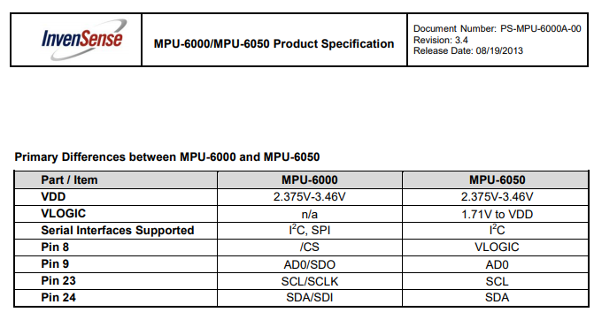

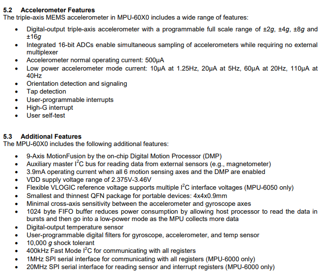

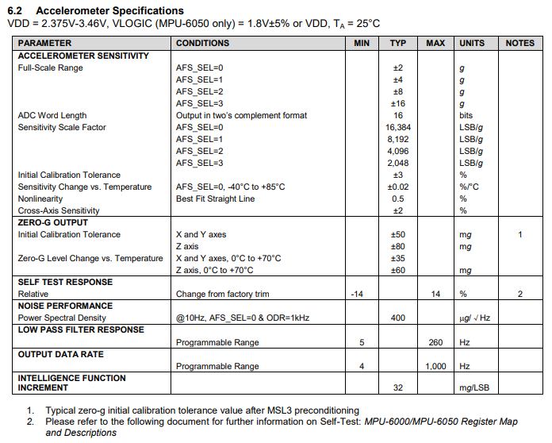

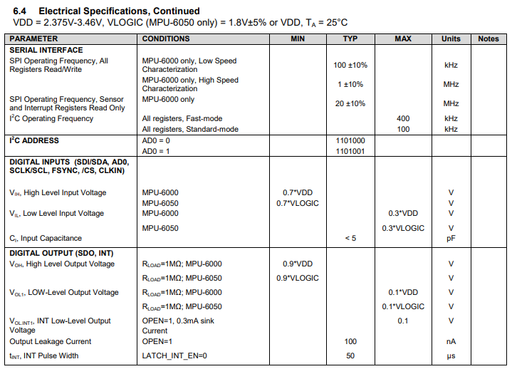

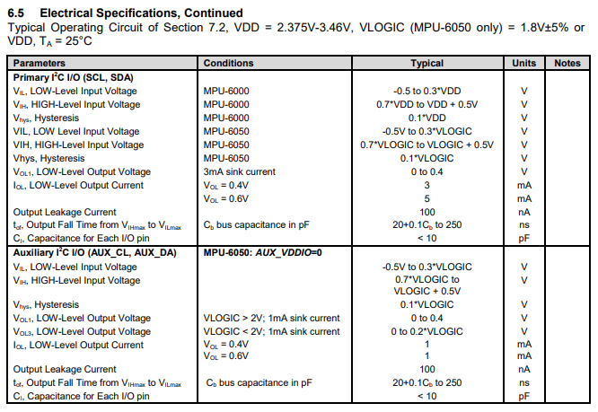

<a id="apendice-a"></a>

## Apêndice A — Códigos históricos

Os dois programas de 2018 estão preservados como fontes em C++, com formatação
atualizada e comportamento histórico mantido. Eles contêm os defeitos descritos
na auditoria e não são o firmware contínuo recomendado:

- [Coleta para caracterização](src/legacy/C_digo1/C_digo1.ino).
- [Instrumento estático original](src/legacy/C_digo2/C_digo2.ino).

O código da revisão dinâmica está em [src/DynamicIMU](src/DynamicIMU/).
Os comandos de build e upload estão no [README](README.md#compilar-e-gravar).

<a id="apendice-b"></a>

## Apêndice B — Desenho mecânico histórico


Fonte: Autor, projeto original de 2018.

<a id="apendice-c"></a>

## Apêndice C — Auditoria técnica da revisão

As evidências abaixo referem-se ao baseline de 2018. “Corrigido” identifica tratamento na revisão; não altera retrospectivamente os ensaios originais. A validação física da revisão dinâmica permanece pendente; os ensaios históricos relatados pelo autor são preservados, embora os CSVs completos não estejam disponíveis para reanálise.

| ID e severidade | Categoria e evidência exata | Consequência e correção proposta | Implementação e verificação | Situação |
|---|---|---|---|---|
| A01 Alta | Defeito confirmado: `C_digo2.ino`, `sumAcZ = ((sumAcZ/400)-(-2540))` seguido de clipping dos AcZ brutos | Muda a referência antes do recorte e corrompe Z. Calibrar uma única vez depois de estatística no mesmo domínio | Comparador Moments sem clipping e Calibration separados. Teste constante −2540 resulta no legado −76,62; diferença 2463,38 contagens | Corrigido na revisão |
| A02 Alta | Defeito: mesmo sketch, segunda soma `sumAcX += AcX[i]` após `sumAcX /= 400`; globais sem reset em nova medição | Contamina a média em 0,25% no caso constante e mistura medidas posteriores. Reiniciar estatísticas explicitamente | Moments local/resetável e Observer::beginCalibration; regressão 1000 → 1002,5 no legado; repetição de inicializações | Corrigido na revisão |
| A03 Média | Divergência documental: monografia p.37, parágrafo 667, Y −2,197; sketch final −2,917; Z também usa −2540 e −2565,7 em etapas distintas | Constantes sem proveniência confiável. Não escolher valor retroativamente | Calibração nominal marcada não medida; script de seis posições com hashes. Texto explica divergência | Documentado; medição pendente |
| A04 Média | Erro aritmético confirmado: equação no parágrafo 674, p.37, `(16782,34−344,968)/0,9986 ≅16400` | Quociente é 16460,4166. Numerador/constante de origem não recuperáveis sem série bruta | recalcular os erros da Tabela 6 e correção explícita junto da equação histórica | Aritmética corrigida; origem incerta |
| A05 Alta | Defeito: `alfa = atan(sumAcZ/sumAcX)` e fórmula beta | Razão perde quadrante e permite divisão por zero; inversão dos três eixos é reflexão se tomada como montagem | inclination usa atan2, singularidade explícita, +X documentado, montagem por quatérnio unitário. Testes de seis faces e cortes | Corrigido na revisão |
| A06 Alta | Erro estatístico: parágrafo 401 e pp.10–11, afirma Allan sempre menor e aplica 2σ a dados individuais; parágrafo 652 usa médias de 5 min | Não justifica clipping gaussiano, unidades e τ insuficientes para reprodução | Seção de ruído reescrita com definição, τ, unidades e NIST; clipping removido do novo estimador | Corrigido; registros históricos ausentes |
| A07 Alta | Falha de reprodutibilidade: `C_digo1.ino` transmite sem tempo nem agendamento; parágrafo 638 declara 30 Hz | Taxa e duração efetivas desconhecidas; UART 9600 limita taxa conforme tamanho variável das linhas | Configuração 50 Hz explícita, DATA_RDY e timestamp de fim de leitura; documentação de perdas estimadas, sem fabricar amostras | Software implementado; taxa física pendente |
| A08 Média | Erro de documentação: parágrafo 562, p.26, descreve esvaziar buffer; sketches usam 0x3B e não habilitam FIFO | Modelo incorreto de frescor | Correção de texto e explicação de burst coerente e sobrescrita conforme InvenSense 4.17–4.19 | Corrigido |
| A09 Alta | Defeito: ambos os sketches ignoram retorno de endTransmission/requestFrom; `Wire.read()<<8` depende do int AVR | Dados parciais/falhos podem parecer medidas; deslocamento de int assinado não é portátil | Leitura validada, timeout 3 ms, identidade/configuração verificadas, signedWord via uint16/int32, saturação e falhas. Bytes testados; build AVR real | Tratado em software; injeção de falhas físicas pendente |
| A10 Alta | Risco confirmado de projeto: display atualizado em cada amostra do sketch final; ausência de limite temporal | Leitura pode se repetir ou ser perdida; não se conhece taxa dinâmica sustentável | Renderização de uma linha por chamada, UART não bloqueante, falha após 30 ms. max_render_us mede desenho; toque e ciclo total exigem analisador | Implementado com aceitação física pendente |
| A11 Média | Consumo confirmado: três arrays de 400 float = 4800 bytes; parágrafos 571/718 e Tabela 5 atribuem erro à quantidade | Memória não foi causa isolada; SRAM e flash são confundidas no texto | Estatística em fluxo, build real final informa 1041 bytes globais; reproduzível pelo script de build descrito no README. Pilha precisa de watermark | Corrigido; pilha pendente |
| A12 Média | Defeito de UI: `btnY2 = height*17/10` fica além do display; hitboxes diferentes dos desenhos; produtos de int16 da barra podem exceder 32767 | Botões e progresso não representam geometria válida | Interface contínua substitui barra e medida sob demanda. Tara/C com regiões limitadas ao display. Calibração e alinhamento do toque dependem da placa | Tratado; touch físico pendente |
| A13 Média | Erro semântico: botão Zerar apenas atribui zero às saídas | Não altera referência nem calibração | Tara de diferenças com wrap; U remove, R invalida, C inicializa; tilt permanece absoluto. Testes de tara, reset e singularidade | Corrigido |
| A14 Média | Alegações históricas: Tabela 6 p.42 e conclusão p.43; oito observações sem repetição | Não demonstram exatidão geral nem dinâmica. Não inferir causa ou intervalo de confiança | Métricas recalculadas: MAE 2,39°, RMSE 2,9827°, máximo 5,95°. Conclusão/abstracts revisados | Corrigido no texto |
| A15 Média | Slides 6, 16 e material de algoritmo: Euler declarado impossível sem três referências; mesa rotativa sem resultados equivalentes; 200 amostras versus 400 | Confunde representação e observabilidade; narrativa incoerente | Apresentação retirada do repositório; as correções conceituais estão incorporadas nesta monografia | Material removido; conteúdo técnico consolidado |
| A16 Média | Artefatos: ficha catalográfica declara 41 f.; campos de banca em branco; apêndices de código; não existem séries brutas/modelos no checkout | Metadados históricos não certificam revisão; caracterização não totalmente reproduzível | Nota de proveniência, apêndices rotulados históricos, scripts de coleta/calibração/replay. Não preencher banca ou inventar registros | Documentado |
| A17 Alta | Limitação física: introdução motiva pernas em movimento, mas implementação usa só acelerômetro | Gravidade/translação ambíguas; yaw sem referência; escala do gyro não identificável em repouso | E1–E8, observador, gate com falso aceite explícito, viés estacionário, protocolo independente. Não há promessa de inclinação sob translação arbitrária | Limitação permanente documentada |
| A18 Média | Limite de calibração/modelo: CSVs históricos indisponíveis para reanálise | Identidade S=B, sensibilidade nominal e gates não são calibração individual | Perfil NOMINAL baseado no manual, ID zero, viés giroscópico estimado em repouso e ajuste de seis posições disponível; sem persistência EEPROM | Ensaios históricos relatados; validação do firmware revisado pendente |
| A19 Baixa | Tabelas de hardware/custos, pp.15–20, são de 2018; descrição de ausência de atenuação MPU não considera DLPF | Comparações obsoletas não justificam escolha atual | Custos rotulados históricos, configuração DLPF explícita. Hardware preservado por compatibilidade | Documentado |
